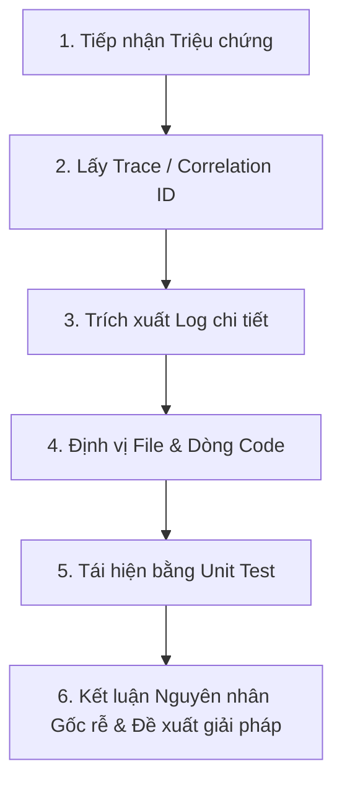

# Production Incident Investigation Skill (Điều Tra Sự Cố Có Bằng Chứng)

Kỹ năng này hướng dẫn Agent điều tra các sự cố production theo chuỗi bằng chứng xác thực, không võ đoán.

## Quy Trình 6 Chặng Chuẩn

### Chặng 1: Tiếp Nhận Triệu Chứng (Symptom)
- Thu thập mô tả lỗi từ người dùng (Ví dụ: "Bấm xác nhận đặt chỗ nhưng báo lỗi 500").
- Ghi nhận thời gian phát sinh sự cố, tài khoản và bãi xe liên quan.

### Chặng 2: Trích Xuất Trace ID & Correlation ID
- Dò tìm mã `X-Correlation-Id` trong header phản hồi hoặc thông báo lỗi giao diện.

### Chặng 3: Thu Thập Log Thực Tế
- Quét log container liên quan:
  `docker logs --tail 200 <service_name> | grep "<correlation_id>"`
- Tìm kiếm từ khóa `ERROR`, `Exception`, `NullPointerException`, `TimeoutException`.

### Chặng 4: Định Vị Đoạn Code Gây Lỗi
- Mở chính xác tệp tin xuất hiện trong Stack Trace.
- Trích dẫn định dạng: `[ClassName.java](file:///path/to/ClassName.java#L120-L135)` và chỉ rõ biến/dòng lệnh phát sinh ngoại lệ.

### Chặng 5: Tái Hiện Bằng Unit Test
- Viết một test case tái hiện dữ liệu đầu vào tương tự trong `src/test/java/...`.
- Xác nhận test bị FAIL khi chạy với mã nguồn hiện tại.

### Chặng 6: Xuất Báo Cáo Sự Cố
- Điền báo cáo theo mẫu [`.agents/templates/incident-investigation-report.md`](file:///d:/Documents/JAVA%20WEB%20SERVICE/SmartParkingHub/.agents/templates/incident-investigation-report.md).
- Trình bày cho người dùng và chờ phê duyệt phương án sửa chữa.
