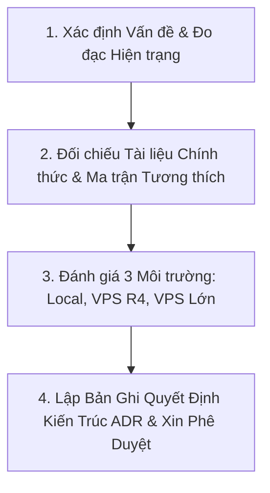

# Chính Sách Ra Quyết Định Công Nghệ Của Agent (Agent Tech Decision Policy)

Quy định này ràng buộc tư duy và hành vi của AI Agent trước khi đưa ra bất kỳ đề xuất thay đổi công nghệ hoặc kiến trúc nào trong SmartParkingHub.

---

## 1. Bộ 5 Câu Hỏi Bắt Buộc (The 5 Guard Questions)
Trước khi đề xuất thêm một thư viện, một dịch vụ mới hoặc nâng cấp framework, Agent **bắt buộc phải trả lời 5 câu hỏi sau**:

1. **Vấn đề cụ thể cần giải quyết là gì?** (Không chấp nhận lý do: *"Để chuẩn hóa theo xu hướng mới"* hoặc *"Vì thư viện này rất hay"*).
2. **Chi phí tài nguyên và vận hành là bao nhiêu?** (RAM, CPU, kích thước Docker image tăng bao nhiêu? VPS R4 có gánh nổi không?).
3. **Mức độ tương thích với hệ sinh thái hiện tại thế nào?** (Có phá vỡ tương thích giữa Spring Boot và Spring Cloud không? Có tương thích với Java 21 hiện có không?).
4. **Giải pháp thay thế đơn giản hơn là gì?** (Có thể dùng tính năng có sẵn của Java 21, Spring Boot hoặc Redis thay vì phải thêm một framework mới không?).
5. **Kế hoạch Rollback nếu gặp sự cố là gì?** (Nếu thư viện mới bị xung đột hoặc lỗi memory leak trên production, làm sao quay về trạng thái cũ dưới 5 phút?).

---

## 2. Quy Trình 4 Bước Đề Xuất Công Nghệ

### Bước 1: Đo Đạc Hiện Trạng
- Cung cấp số liệu cụ thể (ví dụ: "Hiện tại thời gian giữ slot xe bị race condition với 15% lỗi 409, cần cơ chế Redis distributed lock").

### Bước 2: Đối Chiếu Tài Liệu Chính Thức
- Dẫn nguồn tài liệu từ Spring.io, Microsoft Azure Architecture Center, hoặc Docker Docs.
- Cấm tự chế số phiên bản không tồn tại.

### Bước 3: Đánh Giá Tác Động Lên 3 Môi Trường
- Kiểm tra tính khả thi trên cả 3 profile:
  - Máy Local dev.
  - Máy chủ giới hạn tài nguyên (VPS R4).
  - Cụm máy chủ mở rộng (VPS Large).

### Bước 4: Soạn Bản Ghi ADR
- Điền đầy đủ nội dung theo mẫu [adr-template.md](file:///d:/Documents/JAVA%20WEB%20SERVICE/SmartParkingHub/smart-parking-microservice/.agents/templates/adr-template.md).
- Trình bày cho người dùng và **dừng lại chờ phê duyệt**.
