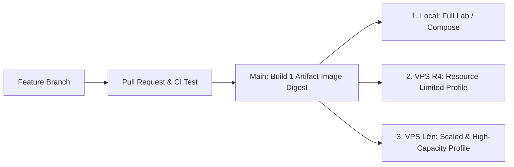

# Chiến Lược Môi Trường: Local → VPS R4 → VPS Lớn Hơn (Environments Strategy)

## 1. Nguyên Tắc Cốt Lõi: Cùng Một Mã Nguồn, Cùng Một Artifact
> **"Local là nơi kiểm thử đầy đủ nhất. VPS R4 là cấu hình triển khai giới hạn tài nguyên. VPS lớn hơn là cấu hình mở rộng năng lực hạ tầng. Cả ba KHÔNG CẦN ba nhánh mã nguồn khác nhau."**

Hệ thống triển khai cùng một container image digest cho cùng một phiên bản release. Sự khác biệt giữa các môi trường được giải quyết thông qua **Docker Compose Overlays** và **Biến Môi Trường (.env)**.

---

## 2. Cấu Trúc Docker Compose Theo Môi Trường

| Tệp Compose | Vai Trò & Ngữ Cảnh Sử Dụng |
| :--- | :--- |
| **`compose.yaml`** | Khai báo cơ bản cho 6 microservices và mạng nội bộ `smart-parking-net`. |
| **`compose.local.yaml`** | Cấu hình cho máy Dev: mount source/logs, expose các port cần debug ra localhost (8080 - 8085). |
| **`compose.local-full.yaml`** | Bổ sung hạ tầng kiểm thử đầy đủ: Kafka KRaft, Redis, Prometheus, Grafana. |
| **`compose.vps-r4.yaml`** | **Cấu hình tối ưu cho VPS giới hạn tài nguyên (Ví dụ: 4GB RAM, 2 vCPU):** • Đặt cứng `mem_limit: 512m` cho từng service. • Giới hạn dung lượng log (`max-size: 50m`, `max-file: 3`). • Chỉ expose cổng Nginx (80/443). Toàn bộ service ẩn hoàn toàn trong mạng nội bộ. |
| **`compose.vps-large.yaml`** | Cấu hình mở rộng khi máy chủ có nhiều tài nguyên (Ví dụ: 16GB+ RAM, 8 vCPU): tăng heap size JVM, scale số lượng replicas cho Booking Service, bật thêm Distributed Tracing (Tempo/Jaeger). |

---

## 3. Luật Bất Khả Xâm Phạm Giữa Các Môi Trường (Inviolable Laws)
Agent **tuyệt đối không được phép** vì lý do VPS R4 yếu tài nguyên hơn mà:
1. **Tắt kiểm tra Authorization** hoặc bỏ qua xác thực JWT.
2. **Tắt validation** của các DTO đầu vào.
3. **Thay đổi quy tắc nghiệp vụ thanh toán PayOS hoặc giữ chỗ bãi xe**.
4. **Bỏ tính Idempotent** của Kafka Consumer.
5. **Dùng chung Database** phá vỡ ranh giới quyền sở hữu dữ liệu.
6. **Thay đổi API Contract** mà không qua quy trình phê duyệt và kiểm thử tương thích.

*Giải pháp cho VPS R4:* Nếu tài nguyên quá hạn chế, hãy giảm số lượng exporter/monitoring nặng, giảm retention của log, hoặc sử dụng dịch vụ database/broker bên ngoài (Managed DB/Kafka) thay vì bớt xén logic bảo mật và tính đúng đắn của ứng dụng!
