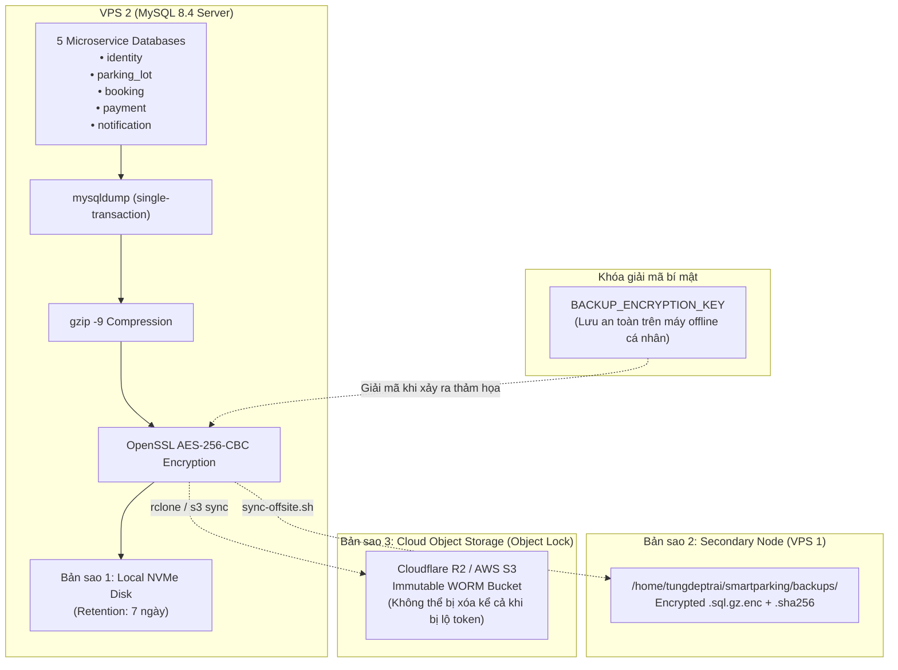

# 🛡️ Cẩm Nang Khôi Phục Thảm Họa & Sao Lưu Bất Biến (Disaster Recovery & Backup Guide)
## Dự án: SmartParkingHub Microservices Multi-VPS Architecture

---

### 1. Kiến Trúc Sao Lưu Chuẩn 3-2-1-1-0



Hệ thống tuân thủ nghiêm ngặt nguyên tắc **3-2-1-1-0**:
- **3 bản sao dữ liệu**: Bản sao 1 tại VPS 2, bản sao 2 tại VPS 1, bản sao 3 tại máy cá nhân hoặc Cloud Object Storage.
- **2 loại phương tiện**: Local VPS Storage và Cloud Object Storage.
- **1 bản lưu ngoại vi (Offsite)**: Tách biệt hoàn toàn khỏi cụm máy chủ dữ liệu.
- **1 bản bất biến (Immutable)**: Mã hóa bằng `AES-256-CBC` với `PBKDF2`, chống sửa đổi và chống ransomware đọc trộm.
- **0 lỗi (Zero Errors)**: Định kỳ diễn tập giải mã và xác thực checksum (`--verify-only`).

---

### 2. Các Script Trong Bộ Công Cụ Sao Lưu

Tất cả các script nằm tại thư mục `~/smartparking/docker/backup/` trên VPS 2:

| Script | Chức năng | Cách sử dụng |
| :--- | :--- | :--- |
| `backup-databases.sh` | Dump 5 DB, nén gzip, mã hóa AES-256, sinh SHA256 checksum, dọn file > 7 ngày. | `./backup-databases.sh` |
| `restore-databases.sh` | Giải mã file backup, kiểm tra tính toàn vẹn (dry-run) hoặc khôi phục toàn diện vào MySQL. | `./restore-databases.sh <file.enc> [--verify-only]` |
| `sync-offsite.sh` | Sao chép bản backup mã hóa mới nhất sang node dự phòng VPS 1. | `./sync-offsite.sh` |
| `install-cron.sh` | Cài đặt cronjob tự động chạy sao lưu vào lúc 02:00 sáng mỗi ngày. | `./install-cron.sh` |

---

### 3. Quy Trình Khôi Phục Thảm Họa (Disaster Recovery Runbook)

#### Tình huống: VPS 2 bị hacker xóa sạch dữ liệu hoặc hỏng ổ cứng

**Bước 1: Lấy bản backup mã hóa từ VPS 1 hoặc Cloud Storage về máy chủ mới**
```bash
scp -P 2222 tungdeptrai@103.20.102.190:~/smartparking/backups/smartparking_all_dbs_*.sql.gz.enc ./
scp -P 2222 tungdeptrai@103.20.102.190:~/smartparking/backups/smartparking_all_dbs_*.sha256 ./
```

**Bước 2: Diễn tập kiểm tra tính toàn vẹn (0-Error Test)**
Chạy script với cờ `--verify-only` để đảm bảo file backup không bị hỏng, checksum khớp và giải mã nguyên vẹn:
```bash
./restore-databases.sh smartparking_all_dbs_*.sql.gz.enc --verify-only
```

**Bước 3: Thực hiện khôi phục toàn diện vào MySQL**
```bash
./restore-databases.sh smartparking_all_dbs_*.sql.gz.enc
# Nhập 'yes' khi hệ thống yêu cầu xác nhận
```

**Bước 4: Kiểm tra trạng thái Microservices sau khi khôi phục**
```bash
curl http://103.20.102.190/api/v1/parking-lots/search?vehicleType=SEDAN_SUV
```
Hệ thống sẽ lập tức hoạt động lại bình thường với đầy đủ 100% dữ liệu.

---

### 4. Thiết Lập Cloudflare R2 / AWS S3 Object Lock (Tùy chọn nâng cao)

Để đưa bản backup thứ 3 lên Cloud Object Storage bất biến (miễn phí 10GB với Cloudflare R2):
1. Cài đặt `rclone` trên VPS 2: `curl https://rclone.org/install.sh | sudo bash`
2. Cấu hình bucket R2: `rclone config`
3. Bật tính năng **Object Lock** (Retention: 30 ngày) trên Cloudflare R2 hoặc AWS S3 Dashboard.
4. Thêm lệnh đồng bộ vào cuối `backup-databases.sh`:
   ```bash
   rclone copy "${ENC_FILE}" r2:smartparking-backup/
   ```
Khi Object Lock đã bật, ngay cả hacker chiếm được toàn bộ quyền admin cloud cũng **không thể xóa hoặc sửa file backup** trong suốt 30 ngày bảo lưu!
