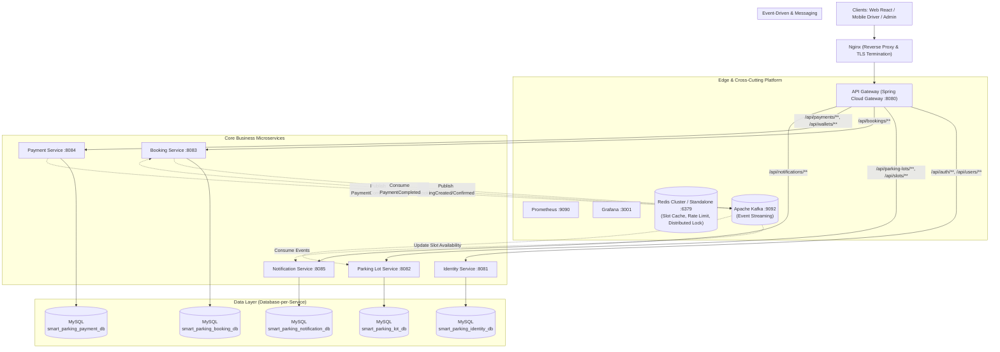

# SmartParkingHub - Tổng quan Kiến trúc Microservices (Architecture Overview)

## 1. Bức tranh tổng thể Hệ thống

Hệ thống **SmartParkingHub** được thiết kế theo mô hình Microservices 6 lớp chuẩn Production nhằm phục vụ nền tảng đặt và quản lý bãi đỗ xe thông minh thời gian thực.

## 2. Phân chia 6 Lớp (6-Layer Architecture)
1. **Edge & Access**: Nginx kết thúc TLS, chuyển tiếp request đến API Gateway. Gateway lọc JWT, rate limiting bằng Redis, inject `X-User-Id`, `X-User-Role`, `X-Correlation-Id`.
2. **Business Services**: Các service nghiệp vụ độc lập (`identity-service`, `parking-lot-service`, `booking-service`, `payment-service`, `notification-service`).
3. **Communication**:
   - *Synchronous (REST / Feign)*: Truy vấn dữ liệu tức thời (VD: Booking gọi ParkingLot lấy thông tin slot).
   - *Asynchronous (Kafka)*: Xử lý quy trình dài, phát sự kiện và thông báo không chặn luồng chính.
4. **Data Layer**: Áp dụng triệt để *Database-per-Service*. Không service nào được truy cập DB của service khác. Đồng bộ dữ liệu qua Eventual Consistency (Kafka) và Transactional Outbox.
5. **Platform & Security**: JWT stateless, secrets quản lý qua Environment Variables, Docker isolated network.
6. **Operations & Observability**: Logs tập trung với Correlation ID, Prometheus thu thập Actuator metrics, Grafana dashboard theo dõi SLO/SLA.
