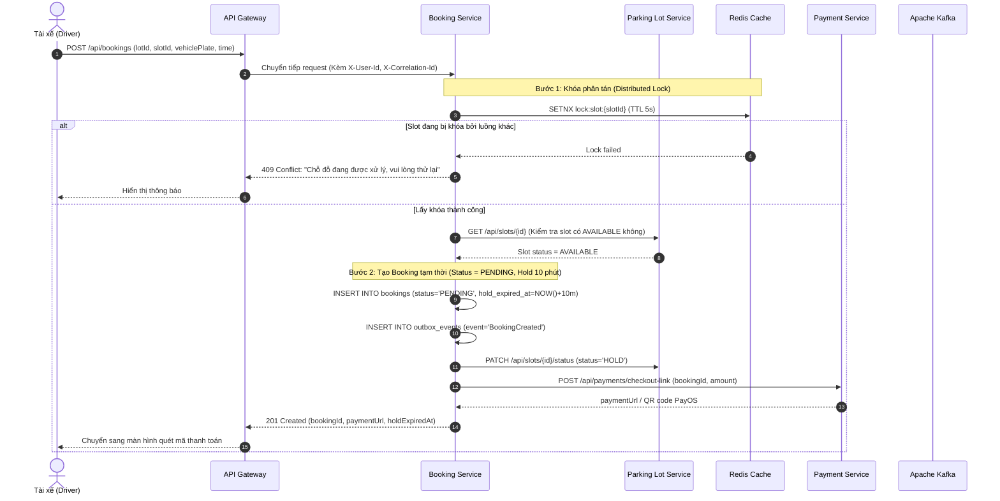

# Luồng nghiệp vụ: Đặt chỗ & Giữ chỗ đỗ xe (Booking & Hold Flow)

## Sơ đồ tuần tự (Sequence Diagram)

## Nhánh thất bại và Xử lý ngoại lệ
1. **Quá 10 phút không thanh toán (`hold_expired_at`)**:
   - `BookingService` chạy Scheduled Job (mỗi 1 phút) quét các booking `PENDING` quá hạn.
   - Chuyển `status = EXPIRED`, ghi Outbox phát sự kiện `BookingCancelledEvent`.
   - `ParkingLotService` nhận event, cập nhật slot về lại `AVAILABLE`.
2. **Khách hàng chủ động hủy**:
   - Chuyển `status = CANCELLED`, nhả slot ngay lập tức.
