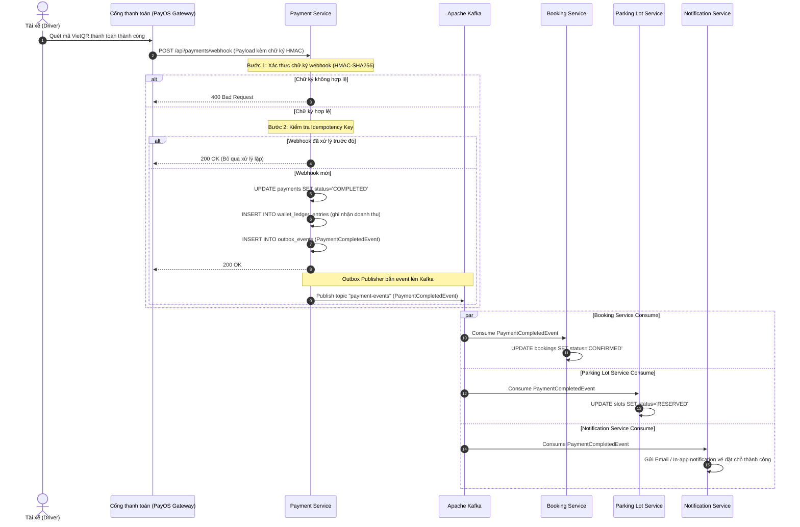

# Luồng nghiệp vụ: Thanh toán & Đối soát (Payment & Settlement Flow)

## Sơ đồ tuần tự (Sequence Diagram)

## Bảo đảm tính toàn vẹn tài chính
1. **Idempotency**: Tránh duplicate callback từ cổng thanh toán.
2. **Double-entry Bookkeeping**: Mọi khoản thu vào đều có bút toán đối ứng vào ví hoặc tài khoản ký quỹ.
3. **Outbox Pattern**: Ngăn ngừa trường hợp DB cập nhật thanh toán thành công nhưng broker Kafka gặp trục trặc gây mất sự kiện.
