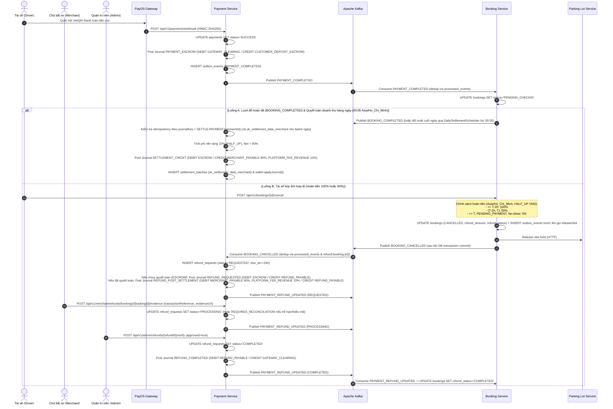

# Luồng nghiệp vụ: Thanh toán, Sổ cái Kép, Quyết toán Ngày & Hoàn tiền Thủ công (Payment, Double-Entry Ledger, Daily Settlement & Manual Refund Flow)

## 1. Hệ thống Tài khoản Sổ cái Kép (6-Account Double-Entry Chart of Accounts)

`payment-service` vận hành trên MySQL 8.4 (Flyway `V1–V5`) với nguyên tắc bất biến: mọi `LedgerJournal` bắt buộc có `total_debit == total_credit` và `Wallet.balance` là hình chiếu (`SUM(credit - debit)`) của tài khoản `MERCHANT_PAYABLE` (chặn ghi đè trực tiếp `wallet.setBalance(...)`).

| Mã tài khoản (`LedgerAccountCode`) | Ý nghĩa nghiệp vụ |
| :--- | :--- |
| `GATEWAY_CLEARING` | Tài khoản đối ứng cổng thanh toán / dòng tiền vào-ra nền tảng |
| `CUSTOMER_DEPOSIT_ESCROW` | Tài khoản ký quỹ tiền cọc của Tài xế đang chờ hoàn tất lượt đỗ hoặc hoàn tiền |
| `MERCHANT_PAYABLE` | Công nợ phải trả cho Chủ bãi xe (số dư khả dụng `wallets.balance`) |
| `MERCHANT_WITHDRAWAL_HOLD` | Số dư phong tỏa tạm thời khi Chủ bãi tạo lệnh rút tiền chờ Admin duyệt |
| `PLATFORM_FEE_REVENUE` | Doanh thu phí nền tảng (8% cho dữ liệu lịch sử V2; 10% từ thời điểm cutover V5) |
| `REFUND_PAYABLE` | Nghĩa vụ hoàn tiền thủ công cho Tài xế khi hủy đặt chỗ hợp lệ |

## 2. Sơ đồ tuần tự: Thanh toán Cọc, Quyết toán Ngày & Saga Hoàn tiền Thủ công

## 3. Bảo đảm tính toàn vẹn tài chính & vận hành
1. **Tách biệt Ký quỹ (Escrow) và Quyết toán (Settlement)**: Khi xác nhận thanh toán (`webhook` hoặc `confirmDemoDeposit`), hệ thống **chỉ** ghi nhận `PAYMENT_ESCROW` (`DEBIT GATEWAY_CLEARING / CREDIT CUSTOMER_DEPOSIT_ESCROW`), tuyệt đối không ghi có ngay vào `MERCHANT_PAYABLE`. Bút toán quyết toán `SETTLEMENT_CREDIT` (`SETTLE:PAYMENT:{paymentId}`) chỉ được thực hiện khi lượt đỗ hoàn tất (`BOOKING_COMPLETED`) hoặc trong phiên quyết toán ngày (`DailySettlementServiceImpl` lúc `00:05 Asia/Ho_Chi_Minh`) đối với phần giá trị ròng chưa hoàn (`paidAmount - refundedAmount`).
2. **Idempotency đa tầng & Bất biến Hoàn tiền Trước/Sau Quyết toán**: Webhook idempotency key, `processed_events` theo `eventId`, `SETTLE:PAYMENT:{paymentId}` trên từng giao dịch, `uk_settlement_date_merchant` cho batch quyết toán ngày, và `refund:booking:{bookingId}` cho yêu cầu hoàn tiền. Dù yêu cầu hoàn tiền (100% hoặc 50%) phát sinh **trước** hay **sau** khi quyết toán, số dư `Wallet.balance` (`MERCHANT_PAYABLE`) và doanh thu phí nền tảng (`PLATFORM_FEE_REVENUE`) cuối cùng đều hội tụ về cùng một giá trị bất biến (ví dụ: giao dịch `100,000 VND` hoàn 50% luôn cho số dư ví chủ bãi `45,000.00 VND` và phí nền tảng `5,000.00 VND`; hoàn 100% cho `0.00 VND`).
3. **Bảo toàn lịch sử V2 (8%) & Phí mới (10%)**: Migration `V5` chuyển đổi các dòng `wallet_ledger_entries` lịch sử (phí 8%) sang `ledger_journals`/`ledger_postings` mà không ghi đè dữ liệu cũ, đồng thời tạo bút toán `OPENING_BALANCE_RECONCILIATION` để khớp nối `wallets.balance == SUM(credit - debit)` trên `MERCHANT_PAYABLE`.
4. **Kiểm soát hoàn tiền thủ công 2 bước**: Nhà xe nộp mã tham chiếu chuyển khoản (`PROCESSING`), chỉ khi Admin xác minh bằng chứng hợp lệ mới chuyển sang `COMPLETED`. Mọi trường hợp thiếu mã giao dịch, nộp quá hạn `due_at` hoặc có tranh chấp đều tự động chuyển sang `REQUIRES_RECONCILIATION`.
5. **Hủy booking — Outbox và releaseSlot**: `cancelBooking` lưu booking và `outbox_events` trong cùng transaction, gọi `saveAndFlush` để mọi lỗi serialize/INSERT/constraint của Outbox nổi lên **trước** khi gọi HTTP `releaseSlot`; lỗi này làm rollback toàn bộ và không gọi `releaseSlot`. Nếu `releaseSlot` lỗi, booking + outbox rollback. Kafka chỉ được gửi trong `afterCommit`. **Giới hạn còn lại:** flush không biến HTTP thành giao dịch phân tán — nếu `releaseSlot` thành công nhưng commit DB thất bại sau đó, slot đã được nhả trong khi booking vẫn ở trạng thái cũ; cần cơ chế đối soát slot (công việc tiếp theo, chưa triển khai).
