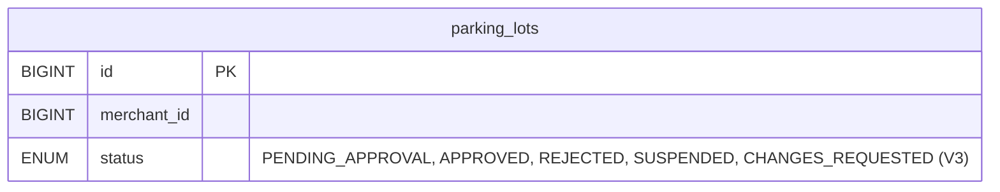
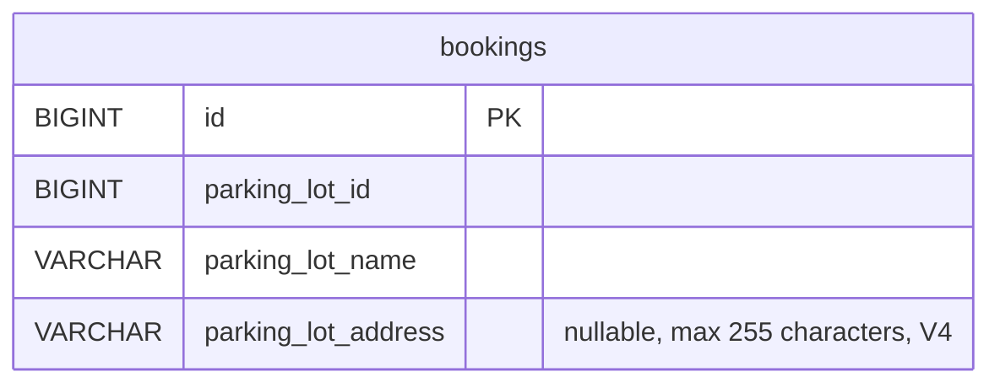

# Data Ownership & Ranh giới Dữ liệu (Database per Service)

Nguyên tắc cốt lõi: **Tuyệt đối không truy cập chéo database**. Mọi truy cập dữ liệu giữa các domain bắt buộc phải thông qua REST API hoặc Message Broker.

| Microservice | Tên Database | Danh sách Bảng sở hữu | Dữ liệu chia sẻ ra ngoài (qua API/Event) |
| :--- | :--- | :--- | :--- |
| **identity-service** | `smart_parking_identity_db` | `users`, `driver_profiles`, `merchant_profiles`, `refresh_tokens` | `userId`, `role`, `fullName`, `phoneNumber`, `email` |
| **parking-lot-service** | `smart_parking_lot_db` | `parking_lots`, `parking_lot_images`, `slots`, `pricing_rules` | `parkingLotId`, `slotId`, `slotCode`, `status`, `hourlyRate` |
| **booking-service** | `smart_parking_booking_db` | `bookings`, `queue_entries`, `outbox_events` | `bookingId`, `status`, `startTime`, `endTime`, `vehiclePlate` |
| **payment-service** | `smart_parking_payment_db` | `payments`, `payment_idempotency_keys`, `wallets`, `wallet_ledger_entries`, `outbox_events` | `paymentId`, `transactionRef`, `status`, `amount` |
| **notification-service** | `smart_parking_notification_db` | `notifications`, `processed_events` | `notificationId`, `status` |

## Quy tắc xử lý dữ liệu liên service

### Email OTP (identity V3)

Identity owns `email_otp_challenges` and `users.email_verified_at`. New registrations verify normalized email, not phone. Old `otp_challenges` simulated phone codes are retained as historical data and cannot verify email. New challenges are unique per recipient/purpose; hashed OTP, five-minute expiry, 60-second resend cooldown, five failed attempts and one-time consumption. Editing email clears its verification timestamp.

Identity calls the notification service's private `POST /api/v1/internal/mail/otp` with `X-Internal-Service-Token` and bounded timeouts/circuit breaker to obtain synchronous SMTP acceptance. Notification uses Spring Mail and does not query identity data or persist plaintext OTP. SMTP acceptance does not guarantee inbox delivery. No OTP is exposed by public API or application logging; SMTP secrets belong only in environment variables. Mailpit is an optional development inbox, never a production sender.

### Parking lot review status (Flyway V3)

`parking-lot-service` owns `parking_lots.status`. V3 appends `CHANGES_REQUESTED`
to the existing MySQL enum so an admin can request changes to a parking lot.
It preserves existing values and their order, `NOT NULL`, and the default
`PENDING_APPROVAL`. Keep V1/V2 unchanged; apply V3 through Flyway.
On application rollback, retain the expanded enum to preserve existing data.

`ParkingLotSchemaMigrationTest` verifies the V1-to-V3 DDL upgrade in H2 MySQL
mode, rejection of the new status before migration, existing row preservation,
round trips for every domain status, the default, and rejection of null/unknown
statuses. Demo seeds are excluded from this automated test; MySQL verification
is also required before deployment because H2 does not reproduce all MySQL DDL behavior.

### Booking address snapshot (Flyway V4)

`bookings.parking_lot_address` is a nullable `VARCHAR(255)` snapshot owned by
booking-service. V4 adds it without changing existing rows; historical bookings
retain `NULL`. Keep V1-V3 unchanged and apply V4 through Flyway before Hibernate
schema validation. On application rollback, retain this optional column.

`BookingSchemaMigrationTest` exercises the V1/V3/V4 DDL upgrade and preservation
of an existing booking using H2 MySQL mode. It excludes demo seeds and does not
replace validation of the full Flyway chain on MySQL before deployment.

### Quy tắc chung

1. **Dữ liệu tổng hợp (Composition)**: Khi client cần xem danh sách Booking kèm tên bãi xe và địa chỉ, Client gọi Gateway hoặc Booking Service thực hiện API Composition (gọi ParkingLot lấy tên bãi xe theo `parkingLotId`). Không bao giờ thực hiện SQL JOIN giữa các database.
2. **Snapshot dữ liệu tại thời điểm giao dịch**: `Booking` lưu snapshot `vehicle_plate`, `total_amount`, và `slot_id`. Nếu bãi xe sau này đổi giá giờ, giá của booking cũ đã lưu vẫn bất biến.

### P0 booking and hold snapshots (2026-11-06)

- booking-service owns request_key, 20% deposit/estimated fee, tariff snapshots (surge/overtime multipliers and surge window) and precise gate timestamps. V5/V6 are additive upgrades; V1–V4 are preserved.
- parking-lot-service owns slot_holds, keyed by booking ID for idempotent hold/release. V4 creates the journal, V5 adds creation time for orphan reconciliation. Missing legacy journals require reconciliation before capacity changes.
- payment-service owns checkout URL, booking expiry snapshot, REQUIRES_REVIEW and reconciliation reason (V4). Booking/payment status coordination uses authenticated internal APIs and typed Kafka events, without querying another service's database.
