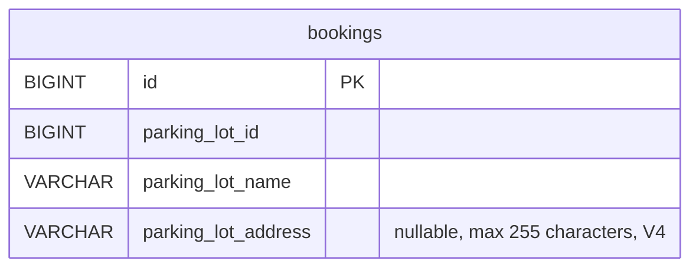

# Data Ownership & Ranh giới Dữ liệu (Database per Service)

Nguyên tắc cốt lõi: **Tuyệt đối không truy cập chéo database**. Mọi truy cập dữ liệu giữa các domain bắt buộc phải thông qua REST API hoặc Message Broker.

| Microservice | Tên Database | Danh sách Bảng sở hữu | Dữ liệu chia sẻ ra ngoài (qua API/Event) |
| :--- | :--- | :--- | :--- |
| **identity-service** | `smart_parking_identity_db` | `users`, `driver_profiles`, `merchant_profiles`, `refresh_tokens` | `userId`, `role`, `fullName`, `phoneNumber`, `email` |
| **parking-lot-service** | `smart_parking_lot_db` | `parking_lots`, `parking_lot_images`, `slots`, `pricing_rules` | `parkingLotId`, `slotId`, `slotCode`, `status`, `hourlyRate` |
| **booking-service** | `smart_parking_booking_db` | `bookings`, `queue_entries`, `outbox_events` | `bookingId`, `status`, `startTime`, `endTime`, `vehiclePlate` |
| **payment-service** | `smart_parking_payment_db` | `payments`, `payment_idempotency_keys`, `wallets`, `wallet_ledger_entries`, `outbox_events` | `paymentId`, `transactionRef`, `status`, `amount` |
| **notification-service** | `smart_parking_notification_db` | `notifications`, `processed_events` | `notificationId`, `status` |

## Quy tắc xử lý dữ liệu liên service

### Booking address snapshot (Flyway V4)

`bookings.parking_lot_address` is a nullable `VARCHAR(255)` snapshot owned by
booking-service. V4 adds it without changing existing rows; historical bookings
retain `NULL`. Keep V1-V3 unchanged and apply V4 through Flyway before Hibernate
schema validation. On application rollback, retain this optional column.

`BookingSchemaMigrationTest` exercises the V1/V3/V4 DDL upgrade and preservation
of an existing booking using H2 MySQL mode. It excludes demo seeds and does not
replace validation of the full Flyway chain on MySQL before deployment.

### Quy tắc chung

1. **Dữ liệu tổng hợp (Composition)**: Khi client cần xem danh sách Booking kèm tên bãi xe và địa chỉ, Client gọi Gateway hoặc Booking Service thực hiện API Composition (gọi ParkingLot lấy tên bãi xe theo `parkingLotId`). Không bao giờ thực hiện SQL JOIN giữa các database.
2. **Snapshot dữ liệu tại thời điểm giao dịch**: `Booking` lưu snapshot `vehicle_plate`, `total_amount`, và `slot_id`. Nếu bãi xe sau này đổi giá giờ, giá của booking cũ đã lưu vẫn bất biến.
