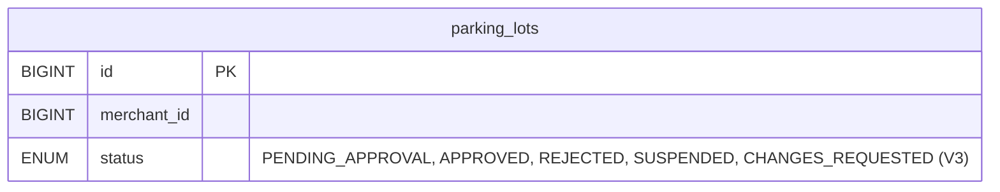
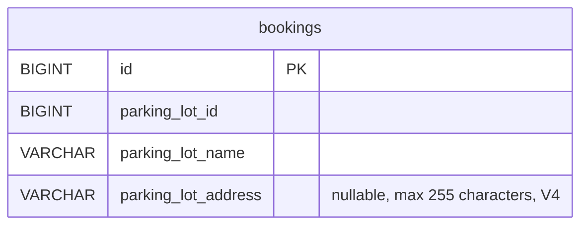

# Data Ownership & Ranh giới Dữ liệu (Database per Service)

## Bổ sung Admin notifications — SP-S3-UI-16 (2026-11-12)

Owner: SPH; code/schema mới đang chờ kiểm chứng runtime. Các thay đổi dưới đây bổ sung cho bảng catalog hiện có, không chuyển quyền sở hữu dữ liệu:

- Identity V7: `admin_event_outbox`, `admin_recipient_snapshot_cursor`; đọc users chỉ trong DB Identity để phát full snapshot ID ADMIN ACTIVE.
- Payment V16: `admin_event_outbox` cho withdrawal/dispute; không đổi bảng/relay outbox_events dùng payment/refund.
- Parking V7: `admin_event_outbox`, cột `parking_lots.review_submission_version` (default 1) cho lần nộp lại hợp lệ, tăng dưới row lock.
- Notification V3: thêm `notifications.source_event_id` nullable, unique source_event_id/user_id, index user_id/created_at/id; thêm `admin_notification_recipients` và `admin_recipient_state` là projection ID/version/timestamp, không sao chép thông tin cá nhân users.
- Không JOIN DB chéo service. Mỗi Admin có notification/readAt riêng; giữ bốn API cũ. Read lặp không cập nhật timestamp cũ.

Migrations lịch sử và dữ liệu đang có được giữ; [ADR](./adr/0005-admin-operations-notification-delivery.md) và [runbook](./deployment/admin-notifications-runbook.md) ghi chính sách snapshot, retry và rollback additive.

Nguyên tắc cốt lõi: **Tuyệt đối không truy cập chéo database**. Mọi truy cập dữ liệu giữa các domain bắt buộc phải thông qua REST API hoặc Message Broker.

| Microservice | Tên Database | Danh sách Bảng sở hữu | Dữ liệu chia sẻ ra ngoài (qua API/Event) |
| :--- | :--- | :--- | :--- |
| **identity-service** | `smart_parking_identity_db` | `users`, `driver_profiles`, `merchant_profiles`, `refresh_tokens`, `email_otp_challenges` | `userId`, `role`, `fullName`, `phoneNumber`, `email` |
| **parking-lot-service** | `smart_parking_lot_db`, private layout filesystem volume (ADR 0006) | `parking_lots`, `parking_lot_images`, `slots`, `slot_holds`, `pricing_rules`, `parking_layouts`, `parking_layout_assets`, `parking_layout_publications`, `physical_parking_slots`, `current_slot_allocations` | `parkingLotId`, `slotId`, `physicalSlotId`, `slotCode`, `status`, `hourlyRate`, `publicationId`, `availability` |
| **booking-service** | `smart_parking_booking_db` | `bookings`, `queue_entries`, `outbox_events`, `processed_events`, `booking_hold_policy_locks`, `booking_hold_rate_windows`, `booking_unpaid_hold_releases` | `bookingId`, `status`, `startTime`, `endTime`, `vehiclePlate`, `refundAmount`, `refundPercentage`, `refundStatus`, `refundPolicy` |
| **payment-service** | `smart_parking_payment_db` | `payments`, `wallets`, `wallet_ledger_entries`, `ledger_journals`, `ledger_postings`, `settlement_batches`, `refund_requests`, `withdrawal_requests`, `disputes`, `outbox_events`, `processed_events` | `paymentId`, `transactionRef`, `status`, `amount`, `refundRequestId`, `refundStatus` |
| **notification-service** | `smart_parking_notification_db` | `notifications`, `processed_events` | `notificationId`, `status` |
| **ai-service** | *(Stateless Vision & Copilot)* | Không lưu bảng DB riêng; xác thực ảnh PNG/JPEG và schema JSON trực tiếp trên bộ nhớ | `grid`, `cells` (`0-based`), `overallConfidence`, `needsHumanReview` |

## Quy tắc xử lý dữ liệu liên service

### Email OTP (identity V3)

Identity owns `email_otp_challenges` and `users.email_verified_at`. New registrations verify normalized email, not phone. Old `otp_challenges` simulated phone codes are retained as historical data and cannot verify email. New challenges are unique per recipient/purpose; hashed OTP, five-minute expiry, 60-second resend cooldown, five failed attempts and one-time consumption. Editing email clears its verification timestamp.

Identity calls the notification service's private `POST /api/v1/internal/mail/otp` with `X-Internal-Service-Token` and bounded timeouts/circuit breaker to obtain synchronous SMTP acceptance. Notification uses Spring Mail and does not query identity data or persist plaintext OTP. SMTP acceptance does not guarantee inbox delivery. No OTP is exposed by public API or application logging; SMTP secrets belong only in environment variables. Mailpit is an optional development inbox, never a production sender.

Registration preflight (2026-11-10): public `POST /api/v1/auth/otp/verify` accepts
`{ email, otpCode }` and returns the standard success envelope with null data.
It checks only REGISTER challenges and shares the expiry, consumed-code checks,
row lock and persisted failed-attempt limit with registration. It does not consume
the code or create an account. The frontend calls it before revealing password
fields. `/register` still rechecks and consumes the OTP in its account-creation
transaction; expiry or resend after preflight can invalidate the original code.

### Parking lot review status (Flyway V3)

`parking-lot-service` owns `parking_lots.status`. V3 appends `CHANGES_REQUESTED`
to the existing MySQL enum so an admin can request changes to a parking lot.
It preserves existing values and their order, `NOT NULL`, and the default
`PENDING_APPROVAL`. Keep V1/V2 unchanged; apply V3 through Flyway.
On application rollback, retain the expanded enum to preserve existing data.

`ParkingLotSchemaMigrationTest` verifies the V1-to-V3 DDL upgrade in H2 MySQL
mode, rejection of the new status before migration, existing row preservation,
round trips for every domain status, the default, and rejection of null/unknown
statuses. Demo seeds are excluded from this automated test; MySQL verification
is also required before deployment because H2 does not reproduce all MySQL DDL behavior.

### Booking address snapshot (Flyway V4)

`bookings.parking_lot_address` is a nullable `VARCHAR(255)` snapshot owned by
booking-service. V4 adds it without changing existing rows; historical bookings
retain `NULL`. Keep V1-V3 unchanged and apply V4 through Flyway before Hibernate
schema validation. On application rollback, retain this optional column.

`BookingSchemaMigrationTest` exercises the V1/V3/V4/V7 DDL upgrade and preservation
of an existing booking using H2 MySQL mode. It excludes demo seeds and does not
replace validation of the full Flyway chain on MySQL before deployment.

### Quy tắc chung

1. **Dữ liệu tổng hợp (Composition)**: Khi client cần xem danh sách Booking kèm tên bãi xe và địa chỉ, Client gọi Gateway hoặc Booking Service thực hiện API Composition (gọi ParkingLot lấy tên bãi xe theo `parkingLotId`). Không bao giờ thực hiện SQL JOIN giữa các database.
2. **Snapshot dữ liệu tại thời điểm giao dịch**: `Booking` lưu snapshot `vehicle_plate`, `total_amount`, và `slot_id`. Nếu bãi xe sau này đổi giá giờ, giá của booking cũ đã lưu vẫn bất biến.

### P0 booking and hold snapshots (2026-11-06)

- booking-service owns request_key, 20% deposit/estimated fee, tariff snapshots (surge/overtime multipliers and surge window) and precise gate timestamps. V5/V6 are additive upgrades; V1–V4 are preserved.
- parking-lot-service owns slot_holds, keyed by booking ID for idempotent hold/release. V4 creates the journal, V5 adds creation time for orphan reconciliation. Missing legacy journals require reconciliation before capacity changes.
- payment-service owns checkout URL, booking expiry snapshot, REQUIRES_REVIEW and reconciliation reason (V4). Booking/payment status coordination uses authenticated internal APIs and typed Kafka events, without querying another service's database.

### Sprint 3 Finance Ledger, Cancellation Refund Saga & Vision Layout Extraction (2026-11-10)

- **payment-service (Flyway V5)**:
  - Owns `ledger_journals`, `ledger_postings`, `settlement_batches`, `refund_requests`, and `processed_events` on MySQL 8.4 while preserving `V1–V4` and historical `wallet_ledger_entries` (8% fee rows).
  - Enforces a 6-account double-entry chart of accounts: `GATEWAY_CLEARING`, `CUSTOMER_DEPOSIT_ESCROW`, `MERCHANT_PAYABLE`, `MERCHANT_WITHDRAWAL_HOLD`, `PLATFORM_FEE_REVENUE`, `REFUND_PAYABLE`. Every journal balances (`total_debit == total_credit`), and `wallets.balance` is strictly the projection of `MERCHANT_PAYABLE` (`SUM(credit - debit)`).
  - `settlement_batches` deduplicates daily settlement per `(business_date, merchant_id)` in `Asia/Ho_Chi_Minh` using the 10% platform fee from cutover.
  - `refund_requests` tracks manual refund operations (`NONE`, `REQUESTED`, `PROCESSING`, `COMPLETED`, `FAILED`, `REQUIRES_RECONCILIATION`) with merchant transfer evidence (`transaction_reference`, `evidence_url`) and platform Admin verification (`verified_by`, `verified_at`, `verification_note`).
- **booking-service (Flyway V7)**:
  - Owns `bookings.cancelled_at`, `cancellation_reason`, `refund_amount`, `refund_percentage`, `refund_policy`, `refund_status`, `refund_reference`, and `processed_events`.
  - Applies cancellation policy in `Asia/Ho_Chi_Minh` (`<= T-2h` -> `100%`, `(T-2h, T)` -> `50%` `HALF_UP` VND, `>= T` -> `0%`, `PENDING_PAYMENT` -> `0%`, `No-show` -> `0%`) and persists booking cancellation + outbox atomically.
- **ai-service (`POST /api/v1/ai/extract-layout`)**:
  - Validates multipart PNG/JPEG magic bytes (`<= 10MB`, `<= 4096x4096px`), calls Gemini Vision with a 25s read timeout, and returns schema-validated 0-based `(row, col)` cells (`PARKING_SLOT`, `CHARGING_PILLAR`, `EMERGENCY_EXIT`, `ENTRANCE`, `EXIT`, `DRIVEWAY`, `OBSTACLE`), nullable `dimensionsMeters`, and `needsHumanReview = true` whenever `overallConfidence < 0.75` or any cell confidence `< 0.75`.

### Merchant Bank Profile & Account Holder Name (identity Flyway V5, 2026-11-12)

- **identity-service (Flyway V5)**:
  - Sở hữu `merchants.account_holder_name VARCHAR(100) NULL` (thêm sau `bank_account_num`).
  - Dữ liệu `account_holder_name` là giá trị **tự khai** của Merchant, **chưa được ngân hàng xác minh**.
  - Không tự ép in hoa, không tự loại bỏ dấu tiếng Việt, không tự backfill từ `users.full_name` sang dữ liệu tài khoản đã xác nhận. Dữ liệu lịch sử giữ giá trị `NULL`.
  - Không expose plain số tài khoản ngân hàng trong log hoặc token; GET profile trả số đầy đủ và `maskedBankAccount`.
- **Ranh giới dữ liệu với payment-service**:
  - `payment-service` sở hữu các yêu cầu rút tiền (`withdrawal_requests`). Mỗi `WithdrawalRequest` lưu **snapshot bất biến** các thông tin ngân hàng (`bank_name`, `bank_account_number`, `account_holder_name`) tại thời điểm Merchant tạo lệnh rút.
  - Khi Merchant cập nhật `account_holder_name`, `bank_name` hoặc `bank_account_num` trong `identity-service`, các lệnh rút tiền cũ (`WithdrawalRequest`) trong `payment-service` **hoàn toàn không bị thay đổi**.
  - `payment-service` không truy vấn chéo database `smart_parking_identity_db`.

### Sprint 3 Parking Layout & Physical Slot Booking (Flyway V8 PL / V8 BK, 2026-11-12)

- **parking-lot-service (Flyway V8)**:
  - Sở hữu `parking_layouts`, `parking_layout_assets`, `parking_layout_publications`, `physical_parking_slots`, `current_slot_allocations`, và `slot_holds.physical_slot_id`.
  - Quản lý con trỏ sơ đồ nháp và bản công bố bất biến. File ảnh nguồn (`sources/`) và snapshot JSON (`revisions/`) mặc định lưu trên private filesystem volume của một host parking-lot-service; metadata/checksum và canonical JSON hiện hữu vẫn thuộc MySQL. Xem [ADR 0006](adr/0006-parking-layout-private-filesystem.md); cần backup ngoài VPS và storage chung trước khi scale nhiều host. Chỉ triển khai filesystem cho layout; provider cloud cũ đã được gỡ.
  - Cấp phát `physicalSlotId` UUID bất biến gắn với từng vị trí ô đỗ cụ thể, liên kết 1:1 với `Slot.id` nhóm sức chứa.
  - Sổ phân bổ `current_slot_allocations` duy trì khóa duy nhất `physical_slot_id UNIQUE` và `booking_id UNIQUE` cho các giữ chỗ còn hiệu lực.
- **booking-service (Flyway V8)**:
  - Sở hữu `bookings.physical_slot_id VARCHAR(36) NULL`, `physical_slot_code VARCHAR(50) NULL`, `layout_publication_id VARCHAR(36) NULL`.
  - Lưu snapshot thông tin ô đỗ vật lý do `parking-lot-service` xác nhận tại thời điểm hold thành công. Không có cross-service SQL hay foreign key vật lý giữa hai DB.
  - Khi booking bị hủy, hết hạn hoặc kết thúc, `booking-service` thông báo `parking-lot-service` giải phóng allocation tương ứng một cách idempotent.

### Payment recovery attempts (V18, 2026-11-15)

Payment-service exclusively owns additive `payment_attempt_groups` (booking/type serialization key) and `payment_order_codes` (monotonic unique PayOS order allocation). Each attempt remains a separate `payments` row; all historical order codes, idempotency keys and ledger links remain unchanged. V18 seeds the allocator beyond historical order codes and inserts group keys for existing payments. No database is queried across service boundaries; payable ownership/amount/expiry still come from booking-service. See [PayOS recovery contract](./api-contracts/payos-payment-recovery.md) for retry eligibility, lock order, late-payment reconciliation and rollback.

Retained local lineage update (2026-11-15): the local database can opt into the byte-preserved V6/V7-compatible migration location, described in [local Payment lineage](./api-contracts/payos-local-lineage.md). This adds no new ownership or money rule, keeps canonical migrations unchanged, and preserves every applied old history row. The local service is now UP at V18 after copy verification.

### Unpaid hold policy (Booking V9, 2026-11-15)

Booking exclusively owns `booking_hold_policy_locks`, `booking_hold_rate_windows` and `booking_unpaid_hold_releases`. Releases are idempotent by booking ID, retain their original time, and are not backfilled from historical terminal bookings. Payment owns all deposit-attempt/provider evidence; it exposes UNPAID/PROTECTED/UNKNOWN via an authenticated internal RPC without creating ledger entries. Booking derives quota/cooldown from its own persisted state. See [unpaid hold contract](./api-contracts/unpaid-hold-policy.md) for limits, locking, late-payment protection, configuration and rollback. Local Booking is at V9; local Payment remains at V18 after preserved-data copy verification.
