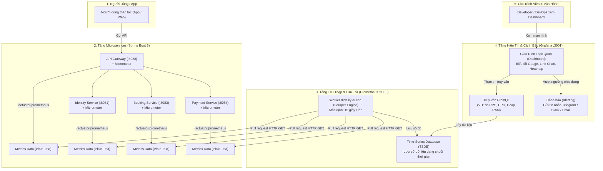

# Hướng Dẫn Toàn Diện Về Prometheus & Grafana Cho Người Mới Bắt Đầu

> Tài liệu này được thiết kế trực quan, dễ hiểu nhất dành cho người mới bắt đầu học và làm việc với hệ thống giám sát (**Monitoring & Observability**) trong kiến trúc Microservices của dự án **SmartParkingHub**.

---

## 1. Tại Sao Cần Giám Sát Trong Microservices?

### Ẩn Dụ Thực Tế: Phòng Cấp Cứu Bệnh Viện
Hãy tưởng tượng hệ thống phần mềm của bạn giống như một **bệnh nhân trong phòng hồi sức cấp cứu**:
- **Bác sĩ/Y tá** không thể đứng nhìn chằm chằm vào bệnh nhân 24/7 để đoán xem họ có khỏe không.
- Bệnh viện phải gắn các **cảm biến nhịp tim, đo huyết áp, nồng độ oxy**.
- Các cảm biến này liên tục đo lường và đưa dữ liệu về một **máy theo dõi (Monitor)** hiển thị đồ thị nhịp tim nhảy nhót sinh động. Khi nhịp tim tụt quá thấp hoặc huyết áp tăng vọt, máy phát còi hú **"Tít tít tít"** cảnh báo.

```
┌────────────────────────────────────────────────────────────────────────┐
│                        TƯƠNG QUAN HỆ THỐNG                             │
│                                                                        │
│   Spring Boot Service        =  Bệnh nhân mang cảm biến               │
│   Micrometer / Actuator      =  Cảm biến đo nhịp tim, huyết áp        │
│   Prometheus                 =  Hồ sơ bệnh án & Máy thu thập dữ liệu   │
│   Grafana                    =  Màn hình hiển thị đồ thị nhịp tim     │
└────────────────────────────────────────────────────────────────────────┘
```

Trong hệ thống **Monolith (nguyên khối)**, bạn chỉ có 1 ứng dụng duy nhất. Nếu nó sập, bạn vào đọc file log là xong.  
Nhưng trong **Microservices**, bạn có 6, 10, thậm chí hàng chục service độc lập (`api-gateway`, `identity`, `parking-lot`, `booking`, `payment`, `notification`):
- Làm sao biết service nào đang ngốn 95% RAM làm đơ máy?
- Làm sao biết API thanh toán của `payment-service` đang bị lỗi 500 hàng loạt?
- Làm sao biết có bao nhiêu tài xế đang gọi vào đặt chỗ mỗi giây?

👉 **Prometheus và Grafana sinh ra để giải quyết triệt để bài toán này.**

---

## 2. Mô Hình Hoạt Động Tổng Thể (End-to-End Architecture)

Dưới đây là sơ đồ dòng chảy dữ liệu từ lúc User bấm nút cho đến khi số liệu hiện lên màn hình Grafana:



---

## 3. Prometheus Là Gì? Chi Tiết Cách Hoạt Động

### 3.1. Bản chất của Prometheus
Prometheus là một công cụ mã nguồn mở chuyên về:
1. **Thu thập dữ liệu định kỳ (Scraping)** từ các dịch vụ.
2. **Lưu trữ dữ liệu dạng Time-Series (TSDB):** Nghĩa là mọi dữ liệu lưu lại đều gắn chặt với một mốc thời gian cụ thể (timestamp).
3. **Cung cấp ngôn ngữ truy vấn PromQL:** Giúp bạn tính toán, cộng trừ nhân chia số liệu theo thời gian (ví dụ: tốc độ tăng trưởng request trong 5 phút qua).

---

### 3.2. Cơ chế PULL (Kéo) - Vũ khí bí mật của Prometheus
Có 2 cơ chế thu thập dữ liệu phổ biến:
- **Cơ chế PUSH (Đẩy):** Từng microservice tự chủ động gửi dữ liệu về server trung tâm.
  - *Nhược điểm:* Khi microservice gặp bão traffic (ví dụ 10.000 user ùa vào), bản thân nó đã quá tải mà còn phải gánh thêm việc gửi dữ liệu đi, rất dễ chết chùm server giám sát.
- **Cơ chế PULL (Kéo - Cách Prometheus dùng):**
  - Từng microservice chỉ cần tính toán và để sẵn dữ liệu tại địa chỉ `/actuator/prometheus`.
  - Prometheus sẽ đóng vai trò **"nhân viên kiểm toán"**: Cứ mỗi 15 giây (Scrape Interval), Prometheus chủ động gửi một request HTTP GET tới từng service để "bốc" dữ liệu về.
  - *Ưu điểm:* Service không bị gánh nặng, Prometheus tự điều tiết được nhịp độ thu thập. Nếu 1 service chết, Prometheus lập tức biết ngay vì không kéo được dữ liệu (đánh dấu service đó là `DOWN`).

---

### 3.3. Dữ liệu Metric thực tế trông như thế nào?
Khi Prometheus gọi vào `http://identity-service:8081/actuator/prometheus`, nó nhận về các dòng chữ thô như sau:

```text
# HELP jvm_memory_used_bytes The amount of used memory
# TYPE jvm_memory_used_bytes gauge
jvm_memory_used_bytes{area="heap",id="G1 Survivor Space",} 1.048576E7
jvm_memory_used_bytes{area="heap",id="G1 Old Gen",} 4.521984E7

# HELP http_server_requests_seconds Duration of HTTP server request handling
# TYPE http_server_requests_seconds summary
http_server_requests_seconds_count{method="POST",status="200",uri="/api/v1/auth/login",} 142.0
http_server_requests_seconds_count{method="POST",status="401",uri="/api/v1/auth/login",} 5.0
```

#### Một Metric bao gồm 4 phần chính:
1. **Metric Name:** Tên chỉ số (VD: `http_server_requests_seconds_count` - số lượng request đến server).
2. **Labels (Nhãn trong ngoặc nhọn `{}`):** Thông tin chi tiết để lọc (VD: `method="POST"`, `status="200"`, `uri="/api/v1/auth/login"`).
3. **Timestamp:** Thời điểm ghi nhận (Prometheus tự gắn lúc bốc về).
4. **Value:** Giá trị đo được (VD: `142.0` lần).

---

### 3.4. Bốn loại Metric cơ bản trong Prometheus

| Loại Metric | Đặc điểm | Ví dụ thực tế |
| :--- | :--- | :--- |
| **Counter (Bộ đếm)** | Giá trị **chỉ tăng lên**, chỉ reset về 0 khi khởi động lại ứng dụng. | Số lượng request gọi vào API, tổng số giao dịch thành công, số lỗi 500 phát sinh. |
| **Gauge (Đồng hồ đo)** | Giá trị **có thể tăng hoặc giảm** tự do bất kỳ lúc nào. | Dung lượng RAM đang dùng, nhiệt độ CPU, số connection đang mở tới MySQL. |
| **Histogram** | Chia dữ liệu thành các khoảng (buckets) để thống kê phân phối. | Thời gian phản hồi của API (có bao nhiêu request dưới 100ms, bao nhiêu dưới 500ms, bao nhiêu trên 2s). |
| **Summary** | Tương tự Histogram nhưng tính toán sẵn các tỷ lệ phần trăm (percentiles: p50, p95, p99). | 99% người dùng nhận kết quả tìm kiếm bãi xe dưới 250ms. |

---

### 3.5. Cấu hình thực tế trong dự án SmartParkingHub
Hãy nhìn vào file [`docker/prometheus/prometheus.yml`](file:///d:/Documents/JAVA%20WEB%20SERVICE/SmartParkingHub/smart-parking-microservice/docker/prometheus/prometheus.yml):

```yaml
global:
  scrape_interval: 15s      # Cứ 15 giây Prometheus sẽ đi "hỏi thăm" 1 lần

scrape_configs:
  - job_name: 'api-gateway'
    metrics_path: '/actuator/prometheus'
    static_configs:
      - targets: ['api-gateway:8088']

  - job_name: 'identity-service'
    metrics_path: '/actuator/prometheus'
    static_configs:
      - targets: ['identity-service:8081']

  - job_name: 'parking-lot-service'
    metrics_path: '/actuator/prometheus'
    static_configs:
      - targets: ['parking-lot-service:8082']
```

---

## 4. Grafana Là Gì? Chi Tiết Cách Hoạt Động

### 4.1. Bản chất của Grafana
Nếu Prometheus là **"cái kho chứa hàng tỷ con số khô khan"**, thì Grafana chính là **"người nghệ sĩ biến những con số đó thành bức tranh rực rỡ"**.

- **Grafana KHÔNG lưu trữ dữ liệu nghiệp vụ:** Bản thân Grafana là một công cụ hiển thị (Visualization Tool).
- **Kết nối linh hoạt (Data Sources):** Grafana có thể lấy dữ liệu từ Prometheus, MySQL, PostgreSQL, Elasticsearch, InfluxDB, CloudWatch...
- **Dashboard & Panel:** Một bảng điều khiển (Dashboard) chứa nhiều khung hình (Panels): biểu đồ đường, đồng hồ tốc độ (Gauge), biểu đồ nhiệt (Heatmap), bảng thống kê...
- **Hệ thống Cảnh báo (Alerting Engine):** Khi một chỉ số vượt ngưỡng (ví dụ: Tỷ lệ lỗi 500 vượt 5% trong 3 phút liên tục), Grafana sẽ gửi thông báo qua Discord, Telegram, Slack hoặc Email cho đội kỹ thuật.

---

### 4.2. So Sánh Nhanh: Prometheus vs Grafana

| Tiêu chí | Prometheus | Grafana |
| :--- | :--- | :--- |
| **Vai trò chính** | Thu thập và lưu trữ số liệu (Metrics Collection & Storage) | Vẽ biểu đồ và hiển thị trực quan (Visualization & Dashboard) |
| **Nơi lưu dữ liệu** | Có cơ sở dữ liệu TSDB riêng cực mạnh | Không lưu dữ liệu giám sát (chỉ lưu cấu hình Dashboard) |
| **Giao diện người dùng** | Giao diện đồ thị rất thô sơ, chủ yếu để gõ truy vấn kiểm tra nhanh | Giao diện cực kỳ đẹp mắt, hiện đại, hỗ trợ Dark Mode, kéo thả linh hoạt |
| **Ngôn ngữ sử dụng** | PromQL | Viết query dựa trên nguồn dữ liệu (PromQL, SQL, v.v.) |
| **Mục đích sử dụng** | Phục vụ máy móc tính toán số liệu | Phục vụ con người theo dõi tình trạng sức khỏe hệ thống |

---

## 5. Hướng Dẫn Trải Nghiệm Thực Tế Trên Máy Của Bạn

Hệ thống của bạn đang có cả 2 container này chạy sẵn:
- **Prometheus:** `http://localhost:9090`
- **Grafana:** `http://localhost:3001`

---

### 5.1. Khám phá Prometheus UI (`http://localhost:9090`)

1. Mở trình duyệt truy cập: **`http://localhost:9090`**.
2. Trên thanh menu, bấm vào **Status** -> chọn **Targets**:
   - Bạn sẽ thấy danh sách tất cả microservices (`api-gateway`, `identity-service`, `parking-lot-service`...).
   - Nếu thấy trạng thái màu xanh lá cây **UP**, nghĩa là Prometheus đang kết nối và bốc dữ liệu từ service đó thành công!
3. Quay lại menu **Graph**, thử gõ một số câu lệnh **PromQL** mẫu vào ô tìm kiếm và bấm **Execute**:

```promql
# 1. Xem dung lượng RAM JVM đang dùng (đổi ra Megabytes)
jvm_memory_used_bytes{area="heap"} / 1024 / 1024

# 2. Xem tổng số request gọi vào toàn bộ hệ thống
http_server_requests_seconds_count

# 3. Tính tốc độ request trung bình mỗi giây (RPS - Request Per Second) trong 1 phút qua
rate(http_server_requests_seconds_count[1m])
```

---

### 5.2. Khám phá Grafana UI (`http://localhost:3001`)

1. Mở trình duyệt truy cập: **`http://localhost:3001`**.
2. Đăng nhập:
   - **Tài khoản:** `admin`
   - **Mật khẩu:** `admin` *(nếu hệ thống yêu cầu đổi mật khẩu mới, bạn có thể bấm "Skip" hoặc đặt pass tùy ý)*.
3. **Kiểm tra kết nối Data Source:**
   - Vào menu bên trái: **Connections** -> **Data Sources**.
   - Bạn sẽ thấy data source `Prometheus` trỏ tới `http://prometheus:9090` (được cấu hình sẵn tự động).
4. **Cách Import một Dashboard Spring Boot siêu đẹp chỉ trong 30 giây:**
   - Trong cộng đồng Spring Boot, có một Dashboard cực kỳ nổi tiếng mã số **`4701`** (JVM Micrometer).
   - Trên Grafana, bấm vào biểu tượng dấu cộng `+` ở góc trên bên phải -> chọn **Import dashboard**.
   - Nhập mã số: `4701` -> bấm **Load**.
   - Ở mục chọn Data source, chọn **Prometheus** -> bấm **Import**.
   - **Kết quả:** Ngay lập tức bạn sẽ có một Dashboard chuyên nghiệp với đầy đủ đồ thị:
     - Biểu đồ CPU sử dụng của từng service.
     - Biểu đồ bộ nhớ JVM Heap & Non-Heap.
     - Tần suất chạy Garbage Collection (Dọn rác bộ nhớ).
     - Lưu lượng Request/giây (Throughput) và thời gian phản hồi (Response time).

---

## 6. Bức Tranh Lớn: Bộ Ba Quan Sát (The 3 Pillars of Observability)

Khi làm các hệ thống lớn, bạn sẽ thường xuyên nghe thấy 3 từ này:

```
                      HỆ THỐNG GIÁM SÁT TOÀN DIỆN
                     (Full-stack Observability)
                                │
        ┌───────────────────────┼───────────────────────┐
        ▼                       ▼                       ▼
    METRICS                  LOGS                    TRACES
(Các con số đo đạc)   (Nhật ký sự kiện)       (Dấu chân hành trình)
───────────────────   ─────────────────       ─────────────────────
Đo lường: CPU, RAM,   Ghi lại: "User A vừa    Truy vết 1 request:
Số request, Số lỗi.   đăng nhập sai pass      User -> Gateway -> Booking
                      lúc 21:05".             -> Payment mất bao nhiêu ms.

Công cụ đại diện:     Công cụ đại diện:       Công cụ đại diện:
Prometheus + Grafana  ELK Stack (Elasticsearch,  Zipkin, Jaeger,
                      Logstash, Kibana), Loki OpenTelemetry
```

---
*Tài liệu được khởi tạo phục vụ đào tạo và phát triển hệ thống SmartParkingHub.*
