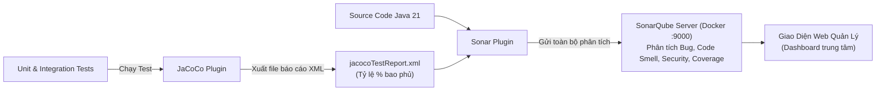

# Hướng Dẫn Sử Dụng SonarQube & JaCoCo Quản Lý Chất Lượng Toàn Diện

> Tài liệu này hướng dẫn cách kiểm định chất lượng mã nguồn, độ bao phủ bài test (**Test Coverage**), quét lỗ hổng bảo mật (**Vulnerabilities**) và phát hiện nợ kỹ thuật (**Code Smells**) cho toàn bộ các Microservices của **SmartParkingHub**.

---

## 1. Kiến Trúc Hoạt Động (SonarQube + JaCoCo)



---

## 2. Cách Khởi Động SonarQube

SonarQube đã được tích hợp sẵn vào file [`docker/docker-compose.infra.yml`](file:///d:/Documents/JAVA%20WEB%20SERVICE/SmartParkingHub/smart-parking-microservice/docker/docker-compose.infra.yml).

### Cách 1: Chạy bằng file script tiện lợi:
Double-click hoặc chạy lệnh trong PowerShell:
```powershell
.\scripts\start-sonarqube.bat
```

### Cách 2: Chạy trực tiếp qua Docker:
```powershell
cd docker
docker compose -f docker-compose.infra.yml up -d sonarqube
```

---

## 3. Truy Cập Giao Diện SonarQube

- **Địa chỉ:** `http://localhost:9000`
- **Tài khoản mặc định:**
  - **Username:** `admin`
  - **Password:** `admin`
- *(Lần đầu tiên đăng nhập, SonarQube sẽ yêu cầu bạn đổi mật khẩu mới, ví dụ: `Admin@123`)*.

---

## 4. Cách Quét Mã Nguồn & Tạo Báo Cáo Chất Lượng

Sau khi SonarQube đã bật tại `http://localhost:9000`, bạn chỉ cần chạy:

```powershell
.\scripts\sonar-scan.bat
```

Script này sẽ tự động:
1. Chạy toàn bộ các bài Unit Test của cả 6 microservice.
2. JaCoCo đo lường và tính toán độ bao phủ (% dòng code, nhánh rẽ).
3. SonarQube quét toàn bộ cấu trúc code Java, phát hiện lỗ hổng bảo mật và gửi kết quả lên `http://localhost:9000`.

---

## 5. Xem Kết Quả Báo Cáo Trên Web
Mở trình duyệt vào: **`http://localhost:9000/dashboard?id=SmartParkingHub`**

Bạn sẽ thấy đầy đủ các chỉ số:
- 🛡️ **Security (Bảo mật):** Đánh giá mức độ an toàn (A - E), cảnh báo SQL Injection, lộ secret token.
- 🧹 **Code Smells:** Các điểm viết code ẩu, hàm quá dài, biến thừa.
- 🧪 **Coverage (%):** Tỷ lệ bao phủ bài test của từng service. Bạn có thể bấm vào từng class để xem dòng nào xanh (đã test), dòng nào đỏ (chưa test).
- 🔄 **Duplications:** Tỷ lệ code bị sao chép lặp lại (copy-paste).
