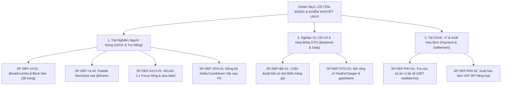

# BẢNG TỔNG HỢP CÁC LỖI TỒN ĐỌNG & KHIẾM KHUYẾT UI/UX VÀ CHI TIẾT THẺ TRELLO

> **Dự án:** SmartParkingHub — Hệ thống Quản lý và Điều hành Bãi đỗ xe Thông minh  
> **Nền tảng Trello:** [Smart Parking Hub - Delivery](https://trello.com/b/QrKLrlz1/smart-parking-hub-delivery)  
> **Thời điểm xác lập:** 14/11/2026  
> **Trạng thái:** Đã phân loại, kiểm chứng thực tế và khởi tạo 8 thẻ Trello chi tiết.

---

## 🧭 1. Ma Trận Phân Loại 8 Khiếm Khuyết Tồn Đọng & Mức Độ Ưu Tiên



---

## 📌 2. Bảng Kê 8 Thẻ Trello Chi Tiết Được Khởi Tạo Trực Tiếp Trên Board

| Mã Thẻ | Tên Thẻ Nghiệp Vụ | Cột Trello | Thành viên phụ trách | Ưu tiên | Story Points |
| :---: | :--- | :--- | :--- | :---: | :---: |
| `SP-DEF-UI-01` | Chuẩn hóa Breadcrumbs & Nút Back Navigation Thống Nhất Trên 38 Trang Chi Tiết | `Project Improvements` | **Hồ Quốc Khải** | **P1 (High)** | **3 STP** |
| `SP-DEF-UI-02` | Đăng Ký Merchant Domain Color Palette Vào `@theme` Tailwind CSS v4 | `Project Improvements` | **Hoàng Đình Tùng** | **P2 (Medium)** | **2 STP** |
| `SP-DEF-A11Y-01` | Khắc Phục Lỗi Trợ Năng WCAG 2.1: Bổ Sung aria-label Cho Icon Buttons & Focus-Visible Ring | `Project Improvements` | **Lâm Gia Huy** | **P1 (High)** | **3 STP** |
| `SP-DEF-STA-01` | Đồng Bộ Delta Countdown Giữ Chỗ 10 Phút Với `expiresAt` Server Sau F5 | `Project Improvements` | **Lâm Gia Huy** | **P1 (High)** | **2 STP** |
| `SP-DEF-BE-01` | Ràng Buộc Nghiệp Vụ: Chặn Phê Duyệt Bãi Xe Có Slot Nhưng Thiếu Bảng Giá PricingRule | `00 - Product Backlog` | **Hoàng Đình Tùng** | **P0 (Critical)** | **3 STP** |
| `SP-DEF-PAY-01` | Xây Dựng Endpoint Tra Cứu Số Dư Ví Nội Bộ Tài Xế `GET /api/v1/wallets/me` | `00 - Product Backlog` | **Huỳnh La Tiến Lộc** | **P0 (Critical)** | **5 STP** |
| `SP-DEF-PAY-02` | Xây Dựng Cơ Chế Xuất Hóa Đơn VAT Hàng Loạt Dạng File Nén ZIP `POST /api/v1/merchant/invoices/bulk-export` | `00 - Product Backlog` | **Huỳnh La Tiến Lộc** | **P1 (High)** | **3 STP** |
| `SP-DEF-DTO-01` | Mở Rộng DTO Bổ Sung Cờ `hasEvCharger` Và `gateName` Cho Chi Tiết Vé Đỗ Xe | `00 - Product Backlog` | **Hồ Quốc Khải** | **P2 (Medium)** | **2 STP** |

---

## 🔍 3. Đặc Tả Chi Tiết Từng Thẻ Lỗi & Kế Hoạch Triển Khai

### 1. `[SP-DEF-UI-01]` Chuẩn hóa Breadcrumbs & Nút Back Navigation Thống Nhất (3 STP)
- **Trello Card ID:** `6af8098fb529c6807d991961`
- **Người phụ trách:** Hồ Quốc Khải (`@HoQuocKhai`)
- **Vấn đề thực tế (ISSUE-NAV-04 & NAV-05):** 38 trang chi tiết cấp 2/3 (Chi tiết đơn đặt chỗ, sửa thông tin bãi, chi tiết khiếu nại...) thiếu nút Back và Breadcrumbs. Người dùng điện thoại không có cách nào quay lại trang trước ngoại trừ nút Back của trình duyệt vốn dễ gây mất dữ liệu form đang nhập dở.
- **Giải pháp:**
  - Nhúng component `Breadcrumb.tsx` và `BackButton.tsx` vào Page Header của 38 trang chi tiết.
  - Thiết lập fallback route an toàn (ví dụ: đang ở `/merchant/parking-lots/15/edit` thì Back về `/merchant/parking-lots/15`).
- **DoD:**
  - 100% các trang chi tiết hiển thị đúng cây phân cấp điều hướng.
  - Phím tắt `Alt + Left Arrow` và thao tác vuốt cạnh hoạt động mượt mà.

---

### 2. `[SP-DEF-UI-02]` Đăng Ký Merchant Domain Color Palette Vào `@theme` (2 STP)
- **Trello Card ID:** `6af80990ead34dd29135d661`
- **Người phụ trách:** Hoàng Đình Tùng (`@TUNG D24TXCN01-N HOANG DINH`)
- **Vấn đề thực tế (ISSUE-TOK-02):** Hơn 200 vị trí trong `src/features/merchant/*` hardcode mã hex thô: `#0d1c2e` (navy), `#455f87` (slate), `#eff4ff` (light blue), `#131b2e` (surface dark) thay vì dùng CSS variables của Tailwind CSS v4.
- **Giải pháp:**
  - Bổ sung cấu hình trong `src/app/styles/theme.css`:
    ```css
    @theme {
      --color-merchant-navy: #0d1c2e;
      --color-merchant-slate: #455f87;
      --color-merchant-tint: #eff4ff;
      --color-merchant-surface: #131b2e;
    }
    ```
  - Thay thế toàn bộ mã hex thô bằng class token chuẩn ngữ nghĩa.
- **DoD:** Quét `ripgrep` không còn bất kỳ chuỗi mã hex nào trôi nổi trong thư mục merchant.

---

### 3. `[SP-DEF-A11Y-01]` Khắc Phục Lỗi Trợ Năng WCAG 2.1 AA (3 STP)
- **Trello Card ID:** `6af809911205c36667ffd264`
- **Người phụ trách:** Lâm Gia Huy (`@Huyy Gia`)
- **Vấn đề thực tế (ISSUE-A11Y-01 & A11Y-02):** Hơn 40 nút Icon-only (nút đóng [X] modal, menu 3 chấm, đổi view lưới/bản đồ) thiếu `aria-label`. Một số form input bị đặt `outline-none` mà không có `focus-visible:ring-2`, gây khó khăn cho người dùng khiếm thị hoặc điều khiển bằng phím Tab.
- **Giải pháp:**
  - Bổ sung `aria-label` mô tả hành vi trực quan cho toàn bộ icon buttons.
  - Bổ sung class `focus-visible:ring-2 focus-visible:ring-brand-primary/50 focus-visible:outline-none`.
- **DoD:** Lighthouse Accessibility Audit trên các màn hình chính đạt điểm $\ge 95/100$.

---

### 4. `[SP-DEF-STA-01]` Đồng Bộ Delta Countdown Giữ Chỗ 10 Phút Với Server (2 STP)
- **Trello Card ID:** `6af809929e5b02c3d88581ed`
- **Người phụ trách:** Lâm Gia Huy (`@Huyy Gia`)
- **Vấn đề thực tế (ISSUE-STA-02):** `BookingHoldingTimer.tsx` lưu số giây còn lại trong local state. Khi người dùng bấm F5 hoặc mở lại tab, đồng hồ có thể bị lệch hoặc đếm lại từ đầu 10:00, dù backend Redis có thể đã hết thời gian giữ chỗ.
- **Giải pháp:**
  - Nhận thời điểm hết hạn `expiresAt` (ISO 8601 UTC) từ server.
  - Tính toán `remainingSeconds = Math.max(0, Math.floor((new Date(expiresAt).getTime() - Date.now()) / 1000))`.
  - Khi chạm 0 giây, tự động kích hoạt modal "Vé giữ chỗ đã hết hạn" và thu hồi slot.
- **DoD:** F5 trang bất kỳ lúc nào, số giây còn lại luôn khớp với TTL trên Redis / Database.

---

### 5. `[SP-DEF-BE-01]` Ràng Buộc Nghiệp Vụ: Chặn Duyệt Bãi Thiếu Bảng Giá (3 STP)
- **Trello Card ID:** `6af80992672967f9e28552df`
- **Người phụ trách:** Hoàng Đình Tùng (`@TUNG D24TXCN01-N HOANG DINH`)
- **Lỗ hổng thực tế (BUG-01):** Bãi đỗ có thể cấu hình slot cho xe Container, Xe tải nặng nhưng chưa khai báo bảng giá theo giờ. Khi Admin phê duyệt bãi, tài xế tìm kiếm thấy giá 0đ hoặc backend tự fallback giá ngầm 20.000đ/giờ.
- **Giải pháp:**
  - Tại `ParkingLotServiceImpl.approveParkingLot()`, bắt buộc kiểm tra invariant:
    $$\forall \text{slot} \in \text{parking\_slots} \text{ với capacity} > 0 \implies \exists \text{pricing\_rule với price} > 0$$
  - Nếu thiếu giá, trả về HTTP 400 Bad Request kèm tên loại xe cần bổ sung biểu phí.
- **DoD:** Admin không thể phê duyệt bất kỳ bãi xe nào nếu chưa có bảng giá đầy đủ cho tất cả loại xe được hỗ trợ.

---

### 6. `[SP-DEF-PAY-01]` API Tra Cứu Số Dư Ví Nội Bộ Tài Xế (5 STP)
- **Trello Card ID:** `6af80993fb97cc6ab7976519`
- **Người phụ trách:** Huỳnh La Tiến Lộc (`@Huynh La Tien Loc`)
- **Khoảng trống thực tế (GAP-A-01):** Driver Portal có màn hình `/driver/wallet` nhưng Backend `payment-service` chưa cung cấp endpoint quản lý số dư ví trả trước cho tài xế.
- **Giải pháp:**
  - Thiết kế entity `DriverWallet` lưu trữ: `availableBalance`, `holdBalance` (tiền cọc đang giữ), `currency`.
  - Mở endpoint `GET /api/v1/wallets/me` được bảo vệ bởi JWT role `DRIVER`.
  - Đấu nối hooks `useDriverWalletQuery` tại Frontend.
- **DoD:** Tài xế đăng nhập xem được số dư thực tế khớp với số dư trên sổ cái kép `driver_ledger_entries`.

---

### 7. `[SP-DEF-PAY-02]` Xuất Hóa Đơn VAT Hàng Loạt Dạng File Nén ZIP (3 STP)
- **Trello Card ID:** `6af80994672967f9e28555cd`
- **Người phụ trách:** Huỳnh La Tiến Lộc (`@Huynh La Tien Loc`)
- **Khoảng trống thực tế (GAP-A-02):** Chủ bãi xe cuối tháng cần tải hàng trăm hóa đơn VAT điện tử dạng PDF/XML để làm việc với cơ quan thuế nhưng hiện tại chỉ có thể tải thủ công từng hóa đơn lẻ.
- **Giải pháp:**
  - Xây dựng endpoint `POST /api/v1/merchant/invoices/bulk-export` tại `payment-service`.
  - Nhận tham số `{ month, year, fileFormat }`, sử dụng `java.util.zip.ZipOutputStream` gom file và trả về nhị phân `application/zip`.
- **DoD:** Tải về file ZIP chứa đầy đủ toàn bộ hóa đơn trong tháng chỉ trong 1 thao tác click.

---

### 8. `[SP-DEF-DTO-01]` Mở Rộng DTO Bổ Sung Cờ hasEvCharger & gateName (2 STP)
- **Trello Card ID:** `6af80995ead34dd29135e2a3`
- **Người phụ trách:** Hồ Quốc Khải (`@HoQuocKhai`)
- **Khoảng trống thực tế (GAP-D-01 & D-02):** 
  - `SlotResponse` thiếu cờ `hasEvCharger` khiến tài xế xe điện không biết khoang đỗ có cổng sạc không.
  - `BookingDetailResponse` thiếu `gateName` khiến tài xế không biết đi vào cổng Barie nào khi bãi có nhiều cổng.
- **Giải pháp:**
  - Bổ sung `Boolean hasEvCharger` trong `SlotResponse.java` (`parking-lot-service`).
  - Bổ sung `String gateName` trong `BookingDetailResponse.java` (`booking-service`).
  - Frontend hiển thị biểu tượng sạc xe điện và nhãn hướng dẫn cổng Barie vào bãi.
- **DoD:** API trả về đầy đủ 2 trường dữ liệu và giao diện vé hiển thị trực quan.
