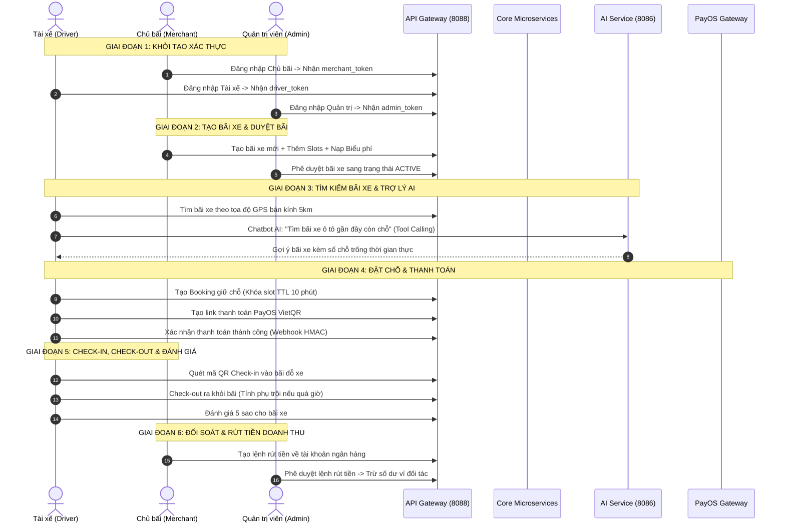

# 📑 SMARTPARKINGHUB - TÀI LIỆU KỊCH BẢN KIỂM THỬ TOÀN DIỆN (FULL TEST SCENARIOS)
## HỆ THỐNG KIỂM THỬ TỰ ĐỘNG END-TO-END VỚI POSTMAN COLLECTION

> **Dự án:** SmartParkingHub (Hệ sinh thái Đặt & Quản lý Bãi đỗ xe Thông minh Microservices)  
> **Phiên bản Collection:** v2.2.0 (Bao gồm AI Copilot, VietQR PayOS, Ledger, Queue & Actuator)  
> **Tệp đính kèm:**
> * 📄 [`SmartParkingHub_API_Collection.postman_collection.json`](./SmartParkingHub_API_Collection.postman_collection.json) (104 Requests / 21 Thư mục)
> * 📄 [`SmartParkingHub_Local_Env.postman_environment.json`](./SmartParkingHub_Local_Env.postman_environment.json) (Environment cấu hình sẵn)

---

## 1. THIẾT LẬP MÔI TRƯỜNG & CHUẨN BỊ (SETUP & PRE-REQUISITES)

### 1.1. Khởi động hệ thống Microservices & Docker
Trước khi bắt đầu chạy bộ test, hãy đảm bảo toàn bộ container và services đã chạy:
```powershell
# Bước 1: Khởi động hạ tầng cơ sở dữ liệu, Redis, Kafka, Monitoring
.\scripts\start-infra.bat

# Bước 2: Build JAR và khởi động toàn bộ Microservices
.\scripts\start-services.bat
```
Kiểm tra đảm bảo 7 service và gateway đã sẵn sàng:
- **API Gateway:** `http://localhost:8088`
- **Identity Service:** Port 8081
- **Parking Lot Service:** Port 8082
- **Booking Service:** Port 8083
- **Payment Service:** Port 8084
- **Notification Service:** Port 8085
- **AI Service:** Port 8086

### 1.2. Nạp Collection & Environment vào Postman
1. Mở ứng dụng **Postman**.
2. Nhấn nút **Import** ở góc trên cùng bên trái.
3. Kéo thả 2 file trong thư mục `postman/`:
   - `SmartParkingHub_API_Collection.postman_collection.json`
   - `SmartParkingHub_Local_Env.postman_environment.json`
4. Ở góc trên bên phải của Postman, chọn Environment là: **`SmartParkingHub - Local Environment`**.

---

## 2. CƠ CHẾ TỰ ĐỘNG HÓA BIẾN MÔI TRƯỜNG (AUTOMATED TEST SCRIPTS)

Toàn bộ bộ Postman Collection đã được cài đặt sẵn các đoạn mã **Postman Test Script** (JavaScript) tự động trích xuất dữ liệu từ Response và nạp vào Environment. Bạn **không cần phải copy-paste thủ công** bất kỳ mã Token, ID hay mã Booking nào:

| Biến môi trường | Nguồn trích xuất tự động | Mục đích sử dụng |
| :--- | :--- | :--- |
| `{{admin_token}}` | `00. Authentication` -> `01. Login as Admin` | Token quyền Quản trị viên tối cao (Super Admin) |
| `{{merchant_token}}` | `00. Authentication` -> `02. Login as Merchant` | Token quyền Đối tác Chủ bãi xe |
| `{{driver_token}}` | `00. Authentication` -> `03. Login as Driver` | Token quyền Tài xế cá nhân |
| `{{token}}` | Cập nhật theo request login gần nhất | Token mặc định cho các request chung |
| `{{vehicleId}}` | `02. Driver - Vehicles` -> `02. Add New Vehicle` | ID xe vừa tạo của tài xế |
| `{{parkingLotId}}` | `04. Merchant - Lots` -> `01. Create Parking Lot` | ID bãi xe vừa tạo của Merchant |
| `{{bookingId}}` | `07. Driver - Booking` -> `01. Create Booking` | ID đơn đặt chỗ vừa tạo |
| `{{bookingCode}}` | `07. Driver - Booking` -> `01. Create Booking` | Mã đặt chỗ (VD: `BK1793...`) để Check-in/out |
| `{{withdrawalId}}` | `11. Withdrawals` -> `01. Request Withdrawal` | ID lệnh rút tiền của chủ bãi |
| `{{disputeId}}` | `12. Disputes` -> `01. Create Dispute` | ID phiếu khiếu nại của tài xế |

---

## 3. KỊCH BẢN 1: LUỒNG NGHIỆP VỤ TOÀN TRÌNH THỰC TẾ (E2E HAPPY PATH)

Đây là kịch bản chuẩn nhất mô phỏng toàn bộ chu trình hoạt động của hệ sinh thái SmartParkingHub: Từ lúc đăng ký tài khoản, chủ bãi tạo bãi xe, tài xế tìm kiếm qua bản đồ hoặc Chatbot AI, đặt chỗ giữ ô đỗ 10 phút, quét mã VietQR thanh toán, check-in vào bãi, check-out tính tiền và chủ bãi rút doanh thu về ngân hàng.



### Các bước thực hiện chi tiết trên Postman:

#### Bước 1: Xác thực & Nạp tự động Token
1. Mở thư mục **`00. Authentication & Quick Logins`**.
2. Chạy `01. Login as Admin` $\rightarrow$ Kiểm tra Status 200, biến `{{admin_token}}` được nạp.
3. Chạy `02. Login as Merchant` $\rightarrow$ Kiểm tra Status 200, biến `{{merchant_token}}` được nạp.
4. Chạy `03. Login as Driver` $\rightarrow$ Kiểm tra Status 200, biến `{{driver_token}}` được nạp.

#### Bước 2: Tài xế thêm phương tiện cá nhân
1. Mở thư mục **`02. Driver - Vehicles Management`**.
2. Chạy `02. Add New Vehicle` với biển số mới (VD: `51K-999.88`, loại `SEDAN_SUV`).
3. Kiểm tra Status 201 Created. Biến `{{vehicleId}}` tự động được gán ID của xe vừa tạo.

#### Bước 3: Chủ bãi tạo bãi đỗ xe & Cấu hình sơ đồ
1. Mở thư mục **`04. Merchant - Parking Lots Management`**.
2. Chạy `01. Create Parking Lot` (Tên bãi: `Bãi xe Trung Tâm Sài Gòn`).
3. Kiểm tra Status 201 Created. Biến `{{parkingLotId}}` tự động lưu ID bãi mới.
4. Chạy `06. Bulk Configure All Vehicle Slots` để tạo tự động 20 slot ô tô (`A1` - `A20`) và 30 slot xe máy.
5. Chạy `08. Bulk Configure Pricing Rules` để nạp biểu phí (VD: 20,000 VND/giờ ban ngày, 30,000 VND/giờ ban đêm).

#### Bước 4: Admin phê duyệt bãi xe
1. Mở thư mục **`17. Admin - Parking Lots Moderation`**.
2. Chạy `03. Admin - Approve Parking Lot`.
3. Kiểm tra Status 200 OK. Trạng thái bãi xe chuyển sang `ACTIVE` và bắt đầu xuất hiện trên bản đồ tìm kiếm.

#### Bước 5: Tìm kiếm bãi xe & Trợ lý thông minh AI Copilot
1. Mở thư mục **`06. Public & Driver - Search & View Lots`**:
   - Chạy `01. Search Parking Lots (Location & Radius)` với tọa độ trung tâm TP.HCM.
   - Xác nhận bãi xe vừa tạo có trong danh sách kết quả với số slot khả dụng (`availableSlots > 0`).
2. Mở thư mục **`19. AI Copilot, Tool Calling & Content Generator`**:
   - Chạy `19.1. Tool Calling - Tìm bãi xe ô tô con (SEDAN_SUV)`.
   - Kiểm tra AI trả về `source: "REALTIME_SLOTS"` cùng danh sách bãi xe gợi ý đúng vị trí.
   - Chạy `19.3. In-Memory RAG - Quy định Giữ chỗ 10 phút & Hủy vé` để kiểm tra trợ lý AI trích dẫn chính sách chính thức.

#### Bước 6: Đặt chỗ giữ ô đỗ (Hold TTL 10 phút)
1. Mở thư mục **`07. Driver - Booking Operations`**.
2. Chạy `01. Create Booking` (Truyền `{{parkingLotId}}`, `{{vehicleId}}`, thời gian vào/ra dự kiến).
3. Kiểm tra Status 201 Created:
   - Biến `{{bookingId}}` và `{{bookingCode}}` được lưu tự động.
   - Trạng thái booking là `PENDING_PAYMENT`.
   - Hạn giữ chỗ `expiresAt` được thiết lập chính xác 10 phút kể từ thời điểm tạo.
   - Slot tương ứng trong `parking-lot-service` chuyển sang trạng thái `HOLD`.

#### Bước 7: Thanh toán tiền cọc qua PayOS VietQR
1. Mở thư mục **`10. Driver - Payments & PayOS Integration`**:
   - Chạy `01. Create Payment Request` $\rightarrow$ Nhận mã thanh toán VietQR và link checkout.
   - Chạy `02. Confirm Demo Payment (Instant Success)` để mô phỏng Webhook ngân hàng báo tiền đã về.
2. Quay lại thư mục **`07. Driver - Booking Operations`**:
   - Chạy `02. Get Booking Details`.
   - Xác nhận trạng thái booking đã chuyển thành `CONFIRMED`.

#### Bước 8: Xe đến bãi Check-in & Rời bãi Check-out
1. Mở thư mục **`08. Merchant - Check-In & Check-Out`**:
   - Chạy `01. Check-In Vehicle into Lot` với `{{bookingCode}}`.
   - Kiểm tra Status 200 OK. Booking đổi thành `CHECKED_IN`, slot đổi thành `OCCUPIED`.
   - Chạy `02. Check-Out Vehicle from Lot`.
   - Kiểm tra Status 200 OK. Hệ thống tính tổng thời gian đỗ, hoàn tất thanh toán, giải phóng slot về lại `AVAILABLE`, và doanh thu tự động ghi nhận vào ví Merchant.

#### Bước 9: Đánh giá chất lượng bãi xe
1. Mở thư mục **`13. Reviews & Ratings`**.
2. Chạy `01. Driver - Create Review` (Chấm 5 sao kèm bình luận khen ngợi).
3. Kiểm tra điểm đánh giá trung bình của bãi xe được cập nhật tự động.

#### Bước 10: Chủ bãi rút tiền doanh thu về tài khoản ngân hàng
1. Mở thư mục **`11. Merchant & Admin - Withdrawals`**:
   - Chạy `01. Merchant - Request Withdrawal` (Nhập số tiền 500,000 VND kèm Tên ngân hàng, Số tài khoản, Tên chủ tài khoản).
   - Kiểm tra Status 201 Created. Biến `{{withdrawalId}}` được lưu.
   - Chạy `03. Admin - Process Withdrawal Request` với quyền Admin để phê duyệt lệnh rút.
   - Kiểm tra trạng thái lệnh rút chuyển thành `APPROVED` và số dư ví đối tác được cập nhật chính xác.

---

## 4. KỊCH BẢN 2: HÀNG ĐỢI THÔNG MINH KHI BÃI XE ĐẦY CHỖ (WAITLIST QUEUE)

Kịch bản kiểm tra khả năng phục vụ khi bãi xe không còn chỗ trống:

1. **Khảo sát bãi xe đầy:** Khi slot `AVAILABLE` của bãi xe bằng 0.
2. **Tài xế tham gia hàng đợi:**
   - Mở thư mục **`09. Driver - Smart Queue System`**.
   - Chạy `01. Join Waitlist Queue`.
   - Kiểm tra Status 201 Created. Tài xế nhận số thứ tự chờ (`queueNumber`) và trạng thái `WAITING`.
3. **Xe khác trả chỗ:**
   - Chạy Check-out giải phóng 1 xe đang đỗ trong bãi.
4. **Hệ thống tự động đôn hàng:**
   - `QueueExpirationScheduler` quét sự kiện và chuyển tài xế đầu hàng đợi sang trạng thái `NOTIFIED`.
   - Cung cấp thời hạn ưu tiên độc quyền **5 phút** cho tài xế tạo booking.
5. **Tài xế nhận chỗ:**
   - Tài xế gọi API `Create Booking` và hoàn tất đặt chỗ thành công.

---

## 5. KỊCH BẢN 3: KIỂM THỬ NGOẠI LỆ, BẢO MẬT & CHỐNG LỖI (NEGATIVE TESTS)

| Mã Case | Tên Kịch Bản Lỗi | Thư Mục / Request | Hành Động Kiểm Thử | Kết Quả Kỳ Vọng |
| :---: | :--- | :--- | :--- | :--- |
| **NEG-01** | Quá hạn giữ chỗ 10 phút | `07. Driver - Booking` | Tạo booking nhưng không thanh toán, đợi scheduler quét sau 10 phút | Booking chuyển sang `EXPIRED`, slot tự động trả về `AVAILABLE` |
| **NEG-02** | Tranh chấp chỗ đỗ (Race condition) | `07. Driver - Booking` | 2 tài xế cùng gửi request đặt 1 slot trong cùng 1 giây | Redis Lock kích hoạt: 1 request thành công (201), 1 request báo lỗi 409 Conflict |
| **NEG-03** | Rút tiền vượt quá số dư ví | `11. Withdrawals` | Merchant yêu cầu rút 100,000,000 VND trong khi ví chỉ có 500,000 VND | Báo lỗi 400 Bad Request: "Số dư khả dụng không đủ để rút" |
| **NEG-04** | Giả mạo Webhook PayOS | `10. Payments` | Gửi Webhook với chữ ký `signature` sai lệch | Bị chặn ngay lập tức với mã 400 Bad Request, không đổi trạng thái đơn hàng |
| **NEG-05** | Webhook lặp (Idempotency) | `10. Payments` | Gửi cùng 1 webhook thanh toán thành công 2 lần liên tiếp | Lần 1 xử lý cộng tiền; lần 2 trả về 200 OK ngay mà không cộng tiền lần 2 |
| **NEG-06** | Truy cập sai phân quyền Role | `17. Admin Moderation` | Dùng `{{driver_token}}` để gọi API duyệt bãi xe của Admin | API Gateway chặn lại với mã lỗi 403 Forbidden |
| **NEG-07** | Token hết hạn / Không hợp lệ | Bất kỳ thư mục nào | Gửi request với header `Authorization: Bearer invalid_token` | Bị chặn với mã 401 Unauthorized |
| **NEG-08** | Chat AI gửi tin nhắn rỗng | `19. AI Copilot` | Gửi body `{ "message": "   " }` | Báo lỗi 400 Bad Request với thông báo validation `@NotBlank` |

---

## 6. KỊCH BẢN 4: KIỂM THỬ SỨC KHỎE HỆ THỐNG & ĐO LƯỜNG (OBSERVABILITY)

Mở thư mục **`20. System Observability & Health Checks`** và chạy lần lượt 8 requests:
1. `01. API Gateway Actuator Health`: Kiểm tra Gateway và kết nối Redis cache `status: UP`.
2. `02 -> 07. Service Actuator Health`: Kiểm tra từng microservice độc lập (Identity, Parking Lot, Booking, Payment, Notification, AI) đảm bảo kết nối database MySQL tương ứng đều `UP`.
3. `08. Prometheus Metrics Endpoint`: Trích xuất số liệu đo lường tài nguyên JVM, số lượng HTTP request và độ trễ phản hồi phục vụ giám sát trên Prometheus/Grafana.

---

## 7. DANH MỤC 21 THƯ MỤC TRONG POSTMAN COLLECTION (104 REQUESTS)

| TT | Tên Thư Mục trong Postman | Số Request | Phân Hệ Phụ Trách | Mục Đích Chính |
| :---: | :--- | :---: | :--- | :--- |
| **00** | `Authentication & Quick Logins` | 7 | `identity-service` | Đăng ký, đăng nhập và tự động nạp Token Admin/Merchant/Driver |
| **01** | `User Profile & Settings` | 3 | `identity-service` | Xem hồ sơ cá nhân, cập nhật thông tin và đổi mật khẩu |
| **02** | `Driver - Vehicles Management` | 4 | `identity-service` | Quản lý danh sách xe cá nhân (Thêm/Sửa/Xóa biển số, loại xe) |
| **03** | `Merchant - Profile & KYC` | 3 | `identity-service` | Nộp hồ sơ doanh nghiệp, cập nhật mã số thuế, giấy phép kinh doanh |
| **04** | `Merchant - Parking Lots Management`| 8 | `parking-lot-service`| CRUD bãi xe, cấu hình slot hàng loạt và nạp biểu phí theo giờ |
| **05** | `Merchant & Public - Images` | 5 | `parking-lot-service`| Quản lý thư viện hình ảnh thực tế của bãi đỗ xe |
| **06** | `Public & Driver - Search Lots` | 4 | `parking-lot-service`| Tìm kiếm bãi xe theo GPS bán kính và xem chi tiết bảng giá |
| **07** | `Driver - Booking Operations` | 4 | `booking-service` | Tạo đặt chỗ giữ ô đỗ 10m, xem chi tiết vé và hủy đặt chỗ |
| **08** | `Merchant - Check-In & Check-Out` | 3 | `booking-service` | Quét mã QR xe vào bãi, check-out tính tiền thực tế và phụ trội |
| **09** | `Driver - Smart Queue System` | 4 | `booking-service` | Xếp hàng chờ bãi xe đầy, nhận thông báo có chỗ và rời hàng đợi |
| **10** | `Driver - Payments & PayOS` | 5 | `payment-service` | Tạo link VietQR PayOS, xử lý Webhook, thanh toán demo tức thì |
| **11** | `Merchant & Admin - Withdrawals` | 3 | `payment-service` | Tạo lệnh rút tiền ngân hàng và Admin duyệt chi |
| **12** | `Disputes Management` | 7 | `payment-service` | Tài xế khiếu nại cước phí và Admin phân xử bồi hoàn |
| **13** | `Reviews & Ratings` | 2 | `booking-service` | Đánh giá số sao và bình luận sau khi hoàn tất lượt đỗ |
| **14** | `Notifications System` | 4 | `notification-service` | Nhận thông báo in-app, đánh dấu đã đọc và xem lịch sử |
| **15** | `Admin - Financial & Dashboard` | 6 | `payment-service` | Báo cáo doanh thu toàn sàn, sao kê sổ cái kế toán kép |
| **16** | `Admin - Users Moderation` | 6 | `identity-service` | Khóa/Mở khóa tài khoản, duyệt hồ sơ KYC của đối tác |
| **17** | `Admin - Parking Lots Moderation`| 5 | `parking-lot-service`| Phê duyệt bãi xe mới đưa lên sàn, tạm dừng bãi vi phạm |
| **18** | `Internal RPC Endpoints` | 3 | Multi-service | Các API nội bộ gọi qua OpenFeign (giữ slot, nhả slot, cập nhật sao) |
| **19** | `AI Copilot, Tool Calling & Content`| 10 | `ai-service` | Chatbot tìm bãi xe thời gian thực, tư vấn RAG, sinh mô tả |
| **20** | `System Observability & Health` | 8 | All Microservices | Kiểm tra sức khỏe Actuator Health Check và Prometheus Metrics |
| **TỔNG**| **21 Thư mục hoàn chỉnh** | **104** | **Toàn bộ hệ thống** | **Phủ kín 100% chức năng dự án** |

---

## 8. HƯỚNG DẪN CHẠY TỰ ĐỘNG BẰNG POSTMAN COLLECTION RUNNER

Để chạy kiểm thử tự động toàn bộ 104 API chỉ với 1 click:
1. Trong Postman, click chuột phải vào thư mục gốc **`SmartParkingHub - Core Microservices API Collection`** $\rightarrow$ Chọn **Run collection**.
2. Tại màn hình Runner:
   - Chọn Environment: **`SmartParkingHub - Local Environment`**.
   - Giữ nguyên thứ tự các thư mục từ `00` đến `20`.
   - Chọn Delay: `50 ms` (để tránh nghẽn luồng xử lý database).
3. Bấm **Run SmartParkingHub...**.
4. Toàn bộ các kịch bản test sẽ được thực thi tự động. Màn hình sẽ hiển thị kết quả **Pass/Fail** trực quan cho từng API.

